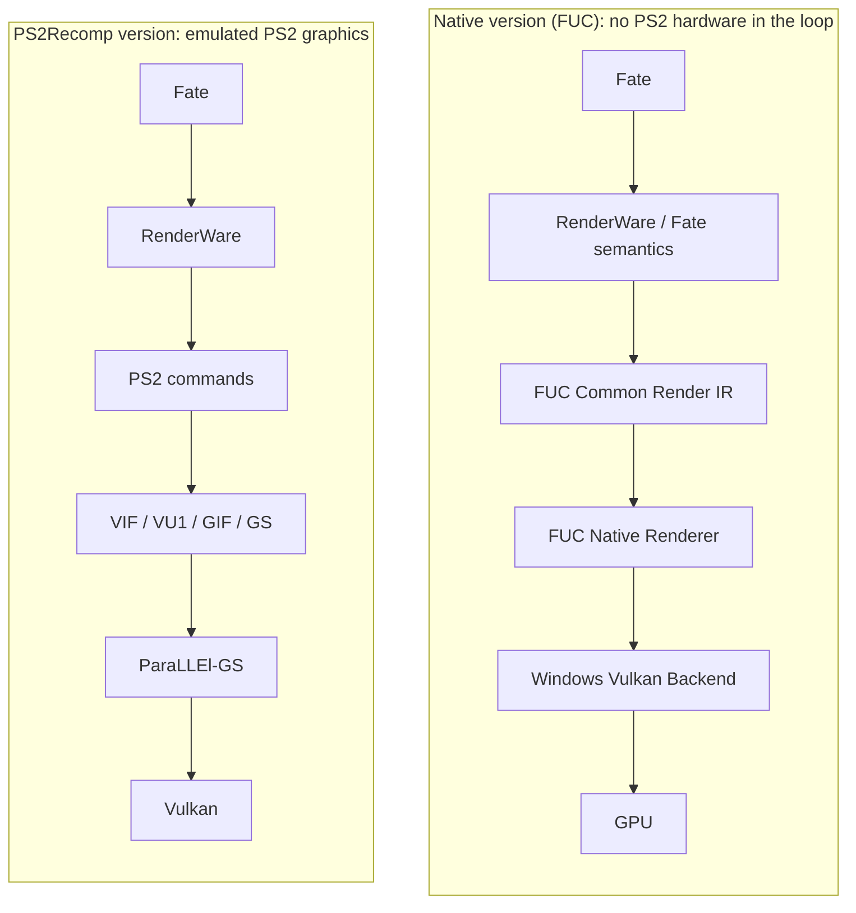

# FUC Community — Fate/unlimited codes, 100% native

[English](#english) · [Español](#español) · [Português](#português)

**EN** — A 100% native Windows version of the PS2 release of *Fate/unlimited codes*: the game's own code,
statically recompiled, with a native renderer that does not depend on PS2 hardware or software.

**ES** — Una versión nativa al 100% para Windows de la edición de PS2 de *Fate/unlimited codes*: el código del propio
juego, recompilado estáticamente, con un renderizador nativo que no depende del hardware ni del software de PS2.

**PT** — Uma versão 100% nativa para Windows da edição de PS2 de *Fate/unlimited codes*: o código do próprio jogo,
recompilado estaticamente, com um renderizador nativo que não depende do hardware nem do software do PS2.

## PS2Recomp version vs native version

> This repository contains **no game files and no code**: only the project's description and its progress figures.
> The PSP-based version remains at [fuc-recomp](https://github.com/elprogramadorloco-arch/fuc-recomp).

<!-- fuc-observer:progress:start -->
## Progress

**⬜ Currently being worked on:** a task outside the effect-program inventory (no effect program is outlined).

| At a glance | Value | Over | Since |
|---|---|---|---|
| Measured battle routes — diagnostic overlay frames | 3227 / 3233 (99.81 %) | diagnostic builds only: the PS2 pass still runs underneath and production has no native render path | 2026-11-05 |
| Effect programs — native coverage | 0 / 443 (0.00 %) | actually executed natively | 2026-10-30 |
| Effect programs — native-ready coverage | 240 / 443 (54.18 %) | static proof only; needs a barrier existing only in diagnostic builds | 2026-11-01 |
| Effect programs — investigated coverage | 443 / 443 (100.00 %) | everything but untouched | 2026-10-30 |

### Game coverage

Only areas with a known inventory get a percentage; the rest say **NOT MEASURED** instead of guessing.

**Since** is the date of the publication from which a row has shown what it shows now.

| Area | Status | What is known | Since |
|---|---|---|---|
| Gameplay / game logic | partly measured | 3 on the PS2 path | 2026-11-05 |
| Characters | partly measured | 18 characters · effect programs only: native 0.0 %, native-ready 53.1 %, investigated 100.0 % | 2026-11-01 |
| Stages | partly measured | 2 on the PS2 path; measured battle routes touch 2 stage IDs | 2026-11-05 |
| Effects | measured | Effect programs · 443 known: native 0.0 %, native-ready 54.2 %, investigated 100.0 % | 2026-11-01 |
| HUD / battle UI | partly measured | 1 on the PS2 path | 2026-11-05 |
| Menus / frontend | partly measured | 4 menu screens of the Practice route: native 0.0 %, native-ready 75.0 %, investigated 100.0 % | 2026-11-08 |
| FMV / cutscenes | partly measured | 1 native, 1 on the PS2 path | 2026-11-05 |
| Audio | partly measured | 1 on the PS2 path | 2026-11-05 |
| Input | partly measured | 1 on the PS2 path | 2026-11-05 |
| Save / load | partly measured | 1 on the PS2 path, 1 not established | 2026-11-05 |
| Storage / assets / loading | partly measured | 2 on the PS2 path | 2026-11-05 |
| Timing / synchronization | partly measured | 1 on the PS2 path | 2026-11-05 |
| Game modes / progression | **NOT MEASURED** | production, one audited route: 1 not established | 2026-11-05 |
| Image correctness | partly measured | one native screen compared with the original game: 44.32 % of pixels exact, 92.86 % within 2 colour levels, none off by more than 16; no pixel parity is claimed; effect programs: all NOT VALIDATED | 2026-11-08 |
| Performance | **NOT MEASURED** | one native menu screen, one session: a frame renders in 0.95 ms (median) and the tick holds 16.65 ms on average; building a frame takes 1.12 ms (median) | 2026-11-08 |
| Stability | **NOT MEASURED** | no supported stability record found | 2026-10-30 |
| Production integration | partly measured | production baseline: recorded; integration items integrated in research: 11 of 15; route steps: 1 native, 1 native guard on PS2 code, 20 on the PS2 path, 2 not established; native components proven outside the build actually used: 5; the build actually used is not PS2-free; native renderer in production: absent; PS2 dependencies: 21 of 42 required at run time, 2 already native; PS2 runtime links removed: 0; final independence gates met: 0 of 6; completion percentage: not claimed by the project | 2026-11-09 |
| Fallback removal | partly measured | diagnostic route fallback: 6 of 3233 frames; effect-program fallback: 15 of 443 programs; passes actually replaced by native code: 0; zero fallback on an admitted slice: NOT MET; known content fallback: NOT MEASURED | 2026-11-05 |
| Global semantic unknowns | partly measured | OPEN: 87; closed or deferred: 41; VM support near 100 % does not close them; later milestones changed entries without restating a total; the project's audit lists the current total as not established | 2026-11-05 |

### Progress history

One row per publication that changed a figure, newest first, with the figures as published that day. A change can
also come from the observer reading the project's records more accurately, not only from new project work.

| Published | Effect programs: native | native-ready | partial | fallback | unknown | Battle route frames | What changed |
|---|---|---|---|---|---|---|---|
| 2026-11-09 | 0 | 240 | 188 | 15 | 0 | 3227 / 3233 diagnostic overlay | Production integration |
| 2026-11-08 | 0 | 240 | 188 | 15 | 0 | 3227 / 3233 diagnostic overlay | Menus / frontend, Performance, Production integration |
| 2026-11-08 | 0 | 240 | 188 | 15 | 0 | 3227 / 3233 diagnostic overlay | Menus / frontend, Image correctness, Performance, Production integration |
| 2026-11-06 | 0 | 240 | 188 | 15 | 0 | 3227 / 3233 diagnostic overlay | Menus / frontend, Production integration |
| 2026-11-06 | 0 | 240 | 188 | 15 | 0 | 3227 / 3233 diagnostic overlay | Menus / frontend, Production integration |
| 2026-11-05 | 0 | 240 | 188 | 15 | 0 | 3227 / 3233 diagnostic overlay | Measured battle routes — diagnostic overlay frames, Gameplay / game logic, Stages, HUD / battle UI, Menus / frontend, FMV / cutscenes, Audio, Input, Save / load, Storage / assets / loading, Timing / synchronization, Game modes / progression, Production integration, Fallback removal, Global semantic unknowns |
| 2026-11-01 | 0 | 240 | 188 | 15 | 0 | 3224 / 3230 native | Effect programs — native-ready coverage, Characters, Effects, Fallback removal |
| 2026-10-31 | 0 | 277 | 35 | 14 | 117 | 3224 / 3230 native | Measured battle routes — native frames, Fallback removal, Global semantic unknowns |
| 2026-10-31 | 0 | 277 | 35 | 14 | 117 | 7009 / 7022 native | Measured battle routes — native frames, Production integration, Fallback removal, Global semantic unknowns |
| 2026-10-30 | 0 | 277 | 35 | 14 | 117 | 3227 / 3233 native | first recorded publication |

### How to read it

Every known item has one state. Today the only complete item census is the game's **effect programs** (the code that
draws visual effects): one square each.

| | State | Meaning | Effect programs |
|---|---|---|---|
| 🟩 | **NATIVE** | executed through the native path with its guards passing | 0 |
| 🟨 | **PARTIAL** | native only under a condition that is not closed yet, or only part of it is native | 188 |
| 🟥 | **FALLBACK** | known and examined, but it still needs the PS2 path | 15 |
| 🟦 | **READY / NOT SEEN** | proven native-ready, but no real run has executed it natively yet | 240 |
| 🟪 | **UNKNOWN** | investigated, but an unresolved question still prevents a verdict | 0 |
| ⬜ | **UNTOUCHED** | known to exist, work has not started | 0 |
| ⬛ | **NOT MEASURED** | no trustworthy inventory or census exists yet |  |
| ⬜ | **white outline** | what is being worked on right now | |

- **Native coverage** counts only items actually executed natively. **Native-ready** adds the ones proven ready but not
  seen running yet. **Investigated** is everything except untouched. The three are never added together.
- **Measured battle routes** count frames of the routes the project measured; they are not whole-game coverage.
  They come from diagnostic builds: a native overlay is drawn while the PS2 pass still runs underneath, and production has no native render path.
- Near-complete effect figures do not mean the whole game is native: most areas are still NOT MEASURED. See *What the
  figures do not measure yet* below.

_Updated 2026-11-09T01:10:07Z. Aggregate figures only, derived from the project's own records by FUC Observer (schema V2). No game data, file names or paths are published. Raw data: [progress.json](progress.json)._
<!-- fuc-observer:progress:end -->

---

## English

### Development status

The native PS2 port is in active development. There is **no public build yet**: this repository publishes the project's
description and its progress, exported automatically from the project's own records (**Progress** above). Releases will
be announced here. The PSP-based version stays at [fuc-recomp](https://github.com/elprogramadorloco-arch/fuc-recomp).

### What is this project?

The goal is a native Windows version of the PS2 release of *Fate/unlimited codes* that runs the game's own logic as native
code, with no emulator, no model of the PS2 hardware and no PS2 software in the loop. **It is not there yet:** today's build
runs the recompiled game on a runtime that still models the PS2 machine.

- **Static recompilation.** The game's executable is translated ahead of time into native code with **PS2Recomp**
  (open-source static recompiler, GPLv3).
- **Fully native rendering.** A native renderer draws what the game asks for: models, stages, fighters, effects, lights
  and fog. The final version has **no PS2 graphics path and no fallback of any kind**. Today the native renderer runs only
  in diagnostic builds, drawing over the game while the PS2 path still runs underneath; the build actually used has no native
  render path yet. The PS2 path will be deleted part by part as each one is really replaced.
- **Proven, not guessed.** Each subsystem (effect VM, resource catalogs, material and texture state, late-bound resources,
  local lights, colour and fog rules…) is reconstructed from the game's own behaviour, and a part only becomes native
  once it is proven to match the original game.
- **Verification.** Results are checked against the original game, with PCSX2 as a read-only reference, and by regression
  test suites.

### Native pipeline explained

A plain PS2 recompilation still emulates the console's graphics hardware: the game's RenderWare calls become PS2 commands
that go through emulated **VIF / VU1 / GIF / GS** and a GS renderer (**ParaLLEl-GS**) on Vulkan. The native version
removes that layer: it takes what the game *means* (RenderWare and Fate's own semantics), turns it into the **FUC Common
Render IR** and draws it with the **FUC Native Renderer** through a **Windows Vulkan backend**, straight to the GPU
(diagram above). That is the goal; today it exists only in diagnostic builds, on top of the PS2 path. "Measured battle routes"
shows how many of the measured battle frames that overlay can already draw (not the whole game).

### Why a 100% native version

- **Faster and lighter:** no emulation of the PS2 graphics chips, so it needs much less CPU and GPU.
- **Real high resolution:** scenes are drawn by a modern renderer, not by enlarging a PS2 image, so higher resolutions,
  widescreen and smoother edges are possible at full quality.
- **Faithful:** the game's own logic is kept and every native part is proven against the original, so gameplay, timing
  and visuals stay the same.
- **Stable:** no emulator timing tricks or hardware hacks; it runs as a normal Windows program on a standard Vulkan driver.
- **Open to improvements:** texture packs, mods, better effects and new graphics options can be built on a clean base.
- **Preservation:** the game keeps running on modern computers without the console or an emulator.

### How to read the progress

- **FUC Native Game Coverage:** every known item has one state (NATIVE, PARTIAL, FALLBACK, READY / NOT SEEN, UNKNOWN,
  UNTOUCHED). Only areas with a known inventory get a percentage; the others say NOT MEASURED instead of guessing.
- **Native, native-ready and investigated coverage** are three separate figures: actually executed natively; passing
  every static check but not seen running yet (and assuming a barrier that exists only in diagnostic builds); examined at all.
  They are never added together.
- **Measured battle routes:** share of the measured battle frames that a native overlay can draw in diagnostic builds, while
  the PS2 path still runs underneath. It is not native execution, and it covers only the routes the project measured.
- **PARTLY MEASURED areas:** the project audited one played route through the build actually used, step by step. That shows
  what the build does in each area, not how much of the area is done, so these areas get no percentage.
- **Effect programs:** the game's visual effect programs, one square each, grouped by character.
- **White outline:** what is being worked on right now.
- **Why native coverage is 0 % today:** an item turns green only when the project records that it actually ran through
  the native path while the game was playing. The project's latest count is zero effect programs: no route activates that path
  yet. Native-ready programs pass the static checks but nobody has seen them run; their squares move from blue to green only
  when a native execution is recorded.
- **Characters, "effect programs only":** for each character only its effect programs are measured. Models, weapons,
  materials, shadows, lights and supers have no inventory yet, so they are NOT MEASURED.
- **Measured battle routes vs native 0 %:** neither says the game already runs natively. The routes count frames of a
  diagnostic overlay with the PS2 path still running; the 0 % counts effect programs that really ran natively. A high route
  figure and a 0 % native figure do not contradict each other.
- The full legend is in **Progress** above. Only aggregate figures are published; no game data.

### What the figures do not measure yet

Reaching 100 % in the progress figures does **not** mean the game is playable yet. They follow the current phase: moving
scene and effect rendering from the emulated PS2 path to the native renderer. The project itself claims no completion
percentage. After that, these steps remain:

1. **The whole game.** The battle routes measured so far cover few characters and stages. Every character, stage, menu,
   character select, HUD, super move, ending and game mode (Arcade, Story, Versus, Practice) must also run with no fallback.
2. **Correct image.** "Supported" or "eligible" means the native renderer can run a program, not that its pixels already
   match the original. Each family of effects and scenes is compared against the original game.
3. **Speed.** Every frame must stay comfortably under 16.67 ms (60 fps). Battles do not reach real time yet in the measured
   builds: the PS2 work still runs, and leftover emulation work and diagnostic hooks still have to be removed.
4. **Release build.** The newest work has to be promoted into the build that is actually used, validated by regression
   tests and a full route. Today that build has no native renderer.
5. **Removing the PS2 path.** Only after the steps above is the emulated path deleted for good.
6. **The rest of the game.** The game logic is the original code, recompiled, and its state still lives in emulated PS2 memory, so
   a native source of game state is still missing. Real-time audio, controller, legitimate save data, loading and long-session
   stability must also be checked end to end.

### Requirements

None yet: there is nothing to download. A future build will require your own lawfully obtained copy of the PS2 game, and
the private build will be generated locally from it, as with the PSP version.

### Roadmap

| Step | Status | Note |
| --- | --- | --- |
| Static recompilation of the game executable | In progress | The game code runs recompiled, on a runtime that still models the PS2 machine. |
| Native renderer for battles | In progress | Diagnostic builds only: it draws over the game while the PS2 path still runs. The build actually used has no native render path. |
| Native game state | Planned | The renderer still reads game state from emulated PS2 memory. |
| Effect programs (VM, catalog, persistence, lights) | In progress | Tracked program by program in Progress (one square per program). |
| Menus, loading screens and other scenes | In progress | The build actually used still takes the PS2 path; native screens exist only in diagnostic builds. |
| Opening movie | In progress | Decoding and display are native in the build actually used; the player around them still takes the PS2 path. |
| Image identical to the original game | In progress | Compared family by family against the original game. |
| Full speed (60 fps on every frame) | In progress | Battles do not reach real time yet in the measured builds. |
| Audio, controller, save data, loading, stability | Planned | Native audio exists only in diagnostic builds. All of it is checked end to end before any public build. |
| Complete removal of the PS2 graphics path | Planned (goal) | The final version contains neither it nor any fallback. |
| Public build and instructions | Planned | Announced here when everything is ready. |

### Legal notice

This is an interoperability and preservation project and this text is not legal advice. It is not affiliated with or
endorsed by Capcom, Type-Moon, Cavia, Sony, or any other rightsholder. All trademarks and copyrighted game material belong
to their respective owners.

This repository does not and will not contain or redistribute game discs or images, executables, BIOS files, extracted
game files, audio, video, textures, models, fonts, save data, generated recompiled code or any build incorporating
game-derived code. The project works only with the user's own legitimately obtained copy; owning a copy does not grant
redistribution rights. PS2Recomp is GPLv3 and keeps its own license and notices. PCSX2 is used only as a read-only
reference for verification and is not part of the project.

---

## Español

### Estado del desarrollo

El port nativo de la versión de PS2 está en desarrollo activo. **Todavía no hay versión pública**: este repositorio publica
la descripción del proyecto y su progreso, exportado automáticamente desde los propios registros del proyecto (**Progress**
arriba). Las versiones se anunciarán aquí. La versión basada en PSP sigue en
[fuc-recomp](https://github.com/elprogramadorloco-arch/fuc-recomp).

### ¿Qué es este proyecto?

El objetivo es una versión nativa para Windows de la edición de PS2 de *Fate/unlimited codes* que ejecute la lógica propia del
juego como código nativo, sin emulador, sin un modelo del hardware de PS2 y sin software de PS2 de por medio. **Todavía no ha
llegado ahí:** la versión de hoy ejecuta el juego recompilado sobre un entorno que sigue modelando la máquina PS2.

- **Recompilación estática.** El ejecutable del juego se traduce por adelantado a código nativo con **PS2Recomp**
  (recompilador estático de código abierto, GPLv3).
- **Renderizado totalmente nativo.** Un renderizador nativo dibuja lo que el juego pide: modelos, escenarios, luchadores,
  efectos, luces y niebla. La versión final **no tiene camino gráfico de PS2 ni respaldo de ningún tipo**. Hoy el renderizador
  nativo solo funciona en versiones de diagnóstico, dibujando encima del juego mientras el camino de PS2 sigue ejecutándose
  debajo; la versión que realmente se usa aún no tiene camino de render nativo. El camino de PS2 se irá borrando parte por parte
  a medida que cada una se reemplace de verdad.
- **Demostrado, no adivinado.** Cada subsistema (máquina virtual de efectos, catálogos de recursos, estado de materiales y
  texturas, recursos enlazados tarde, luces locales, reglas de color y niebla…) se reconstruye a partir del comportamiento
  del propio juego, y una parte solo pasa a ser nativa cuando está demostrado que coincide con el original.
- **Verificación.** Los resultados se comparan con el juego original, usando PCSX2 como referencia de solo lectura, y con
  baterías de pruebas de regresión.

### El camino nativo explicado

Una recompilación de PS2 sin más sigue emulando el hardware gráfico de la consola: las llamadas de RenderWare del juego se
convierten en comandos de PS2 que pasan por **VIF / VU1 / GIF / GS** emulados y por un renderizador de GS (**ParaLLEl-GS**)
sobre Vulkan. La versión nativa elimina esa capa: toma lo que el juego *quiere decir* (la semántica de RenderWare y de Fate),
lo convierte al **FUC Common Render IR** y lo dibuja con el **FUC Native Renderer** a través de un **backend Vulkan para
Windows**, directamente en la GPU (diagrama arriba). Ese es el objetivo; hoy solo existe en versiones de diagnóstico, por encima del camino de PS2. "Measured
battle routes" muestra cuántos de los fotogramas de combate medidos ya puede dibujar esa superposición (no el juego entero).

### Ventajas de una versión 100% nativa

- **Más rápida y ligera:** sin emular los chips gráficos de PS2, necesita mucho menos CPU y GPU.
- **Alta resolución real:** las escenas las dibuja un renderizador moderno, no se amplía una imagen de PS2, así que
  resoluciones altas, pantalla panorámica y bordes más suaves son posibles con calidad completa.
- **Fiel:** se conserva la lógica propia del juego y cada parte nativa se demuestra igual al original, así que la
  jugabilidad, los tiempos y el aspecto se mantienen.
- **Estable:** sin trucos de sincronización de emulador ni parches de hardware; funciona como un programa normal de Windows
  sobre un controlador Vulkan estándar.
- **Abierta a mejoras:** packs de texturas, mods, mejores efectos y nuevas opciones gráficas sobre una base limpia.
- **Preservación:** el juego sigue funcionando en ordenadores modernos sin la consola ni un emulador.

### Cómo leer el progreso

- **FUC Native Game Coverage:** cada elemento conocido tiene un estado (NATIVE, PARTIAL, FALLBACK, READY / NOT SEEN,
  UNKNOWN, UNTOUCHED). Solo las áreas con inventario conocido tienen porcentaje; las demás dicen NOT MEASURED en vez de
  adivinar.
- **Cobertura nativa, lista e investigada** son tres cifras separadas: ejecutado de verdad en nativo; supera todas las
  comprobaciones estáticas pero aún no se ha visto en marcha (y da por hecha una barrera que solo existe en versiones de
  diagnóstico); examinado. Nunca se suman.
- **Measured battle routes:** porcentaje de los fotogramas de combate medidos que una superposición nativa puede dibujar en
  versiones de diagnóstico, mientras el camino de PS2 sigue ejecutándose debajo. No es ejecución nativa, y solo cubre las rutas
  que el proyecto midió.
- **Áreas PARTLY MEASURED:** el proyecto auditó paso a paso una ruta jugada en la versión que realmente se usa. Eso muestra qué
  hace esa versión en cada área, no cuánto del área está hecho, así que estas áreas no tienen porcentaje.
- **Effect programs:** los programas de efectos visuales del juego, un cuadrado cada uno, agrupados por personaje.
- **Contorno blanco:** lo que se está trabajando ahora mismo.
- **Por qué la cobertura nativa es 0 % hoy:** un elemento solo se pone verde cuando el proyecto registra que se ejecutó
  de verdad por el camino nativo con el juego en marcha. El último recuento del proyecto es de cero programas de efectos:
  ninguna ruta activa todavía ese camino. Los programas listos (native-ready) superan las comprobaciones estáticas pero nadie
  los ha visto ejecutarse; sus cuadrados solo pasan de azul a verde cuando se registra una ejecución nativa.
- **Personajes, "effect programs only":** de cada personaje solo se miden sus programas de efectos. Modelos, armas,
  materiales, sombras, luces y supers aún no tienen inventario, así que salen como NOT MEASURED.
- **Rutas de combate medidas frente al 0 % nativo:** ninguna de las dos dice que el juego ya funcione en nativo. Las rutas
  cuentan fotogramas de una superposición de diagnóstico con el camino de PS2 aún en marcha; el 0 % cuenta programas de efectos
  que de verdad se ejecutaron en nativo. Una cifra alta en las rutas y un 0 % nativo no se contradicen.
- La leyenda completa está en **Progress** arriba. Solo se publican cifras agregadas; ningún dato del juego.

### Lo que las cifras aún no miden

Llegar al 100 % en las cifras de progreso **no** significa que el juego ya se pueda jugar. Siguen la fase actual: pasar el
dibujado de escenas y efectos del camino de PS2 emulado al renderizador nativo. El propio proyecto no declara ningún porcentaje
de avance. Después quedan estos pasos:

1. **Todo el juego.** Las rutas de combate medidas hasta ahora cubren pocos personajes y escenarios. También tienen que
   funcionar sin respaldo todos los personajes, escenarios, menús, selección de personaje, HUD, supers, finales y modos de
   juego (Arcade, Story, Versus, Practice).
2. **Imagen correcta.** "Soportado" o "elegible" significa que el renderizador nativo sabe ejecutar un programa, no que sus
   píxeles ya coincidan con el original. Cada familia de efectos y escenas se compara con el juego original.
3. **Velocidad.** Cada fotograma tiene que quedar holgadamente por debajo de 16,67 ms (60 fps). Los combates aún no llegan a
   tiempo real en las versiones medidas: el trabajo de PS2 sigue ejecutándose, y falta retirar trabajo de emulación heredado y
   ganchos de diagnóstico.
4. **Versión de uso.** El trabajo más reciente tiene que pasar a la versión que realmente se usa, validado con pruebas de
   regresión y una ruta completa. Hoy esa versión no tiene renderizador nativo.
5. **Retirar el camino de PS2.** Solo después de los pasos anteriores se elimina definitivamente el camino emulado.
6. **El resto del juego.** La lógica es el código original recompilado, y su estado sigue viviendo en la memoria de PS2 emulada, así
   que aún falta una fuente nativa del estado del juego. También hay que comprobar de punta a punta el audio a tiempo real, el
   mando, las partidas guardadas legítimas, las cargas y la estabilidad en sesiones largas.

### Requisitos

Por ahora ninguno: no hay nada que descargar. Una futura versión requerirá tu propia copia legítima del juego de PS2, y la
versión privada se generará localmente a partir de ella, igual que con la versión de PSP.

### Mapa de ruta

| Paso | Estado | Nota |
| --- | --- | --- |
| Recompilación estática del ejecutable del juego | En curso | El código del juego funciona recompilado, sobre un entorno que sigue modelando la máquina PS2. |
| Renderizador nativo para los combates | En curso | Solo en versiones de diagnóstico: dibuja encima del juego mientras el camino de PS2 sigue ejecutándose. La versión que realmente se usa no tiene camino de render nativo. |
| Estado nativo del juego | Previsto | El renderizador aún lee el estado del juego de la memoria de PS2 emulada. |
| Programas de efectos (VM, catálogo, persistencia, luces) | En curso | Se siguen programa a programa en Progress (un cuadrado por programa). |
| Menús, pantallas de carga y otras escenas | En curso | La versión que realmente se usa sigue por el camino de PS2; las pantallas nativas solo existen en versiones de diagnóstico. |
| Vídeo de apertura | En curso | La decodificación y la imagen son nativas en la versión que realmente se usa; el reproductor que las rodea sigue por el camino de PS2. |
| Imagen idéntica al juego original | En curso | Se compara familia por familia con el juego original. |
| Velocidad completa (60 fps en todos los fotogramas) | En curso | Los combates aún no llegan a tiempo real en las versiones medidas. |
| Audio, mando, partidas guardadas, cargas, estabilidad | Previsto | El audio nativo solo existe en versiones de diagnóstico. Todo se comprueba de punta a punta antes de cualquier versión pública. |
| Eliminación completa del camino gráfico de PS2 | Previsto (objetivo) | La versión final no tendrá ni ese camino ni ningún respaldo. |
| Versión pública e instrucciones | Previsto | Se anunciará aquí cuando todo esté listo. |

### Aviso legal

Este es un proyecto de interoperabilidad y preservación, y este texto no es asesoramiento legal. No está afiliado ni
respaldado por Capcom, Type-Moon, Cavia, Sony ni ningún otro titular de derechos. Todas las marcas y el material del juego
protegido por derechos de autor pertenecen a sus respectivos propietarios.

Este repositorio no contiene ni contendrá ni redistribuirá discos o imágenes del juego, ejecutables, BIOS, archivos
extraídos del juego, audio, vídeo, texturas, modelos, fuentes, partidas guardadas, código recompilado generado ni ninguna
versión que incorpore código derivado del juego. El proyecto trabaja solo con la copia propia y legítima del usuario; tener
una copia no concede derechos de redistribución. PS2Recomp es GPLv3 y conserva su propia licencia y avisos. PCSX2 se usa
solo como referencia de solo lectura para verificar y no forma parte del proyecto.

---

## Português

### Estado do desenvolvimento

O port nativo da versão de PS2 está em desenvolvimento ativo. **Ainda não há versão pública**: este repositório publica a
descrição do projeto e o seu progresso, exportado automaticamente dos próprios registros do projeto (**Progress** acima).
As versões serão anunciadas aqui. A versão baseada no PSP continua em
[fuc-recomp](https://github.com/elprogramadorloco-arch/fuc-recomp).

### O que é este projeto?

O objetivo é uma versão nativa para Windows da edição de PS2 de *Fate/unlimited codes* que execute a lógica do próprio jogo como
código nativo, sem emulador, sem um modelo do hardware do PS2 e sem software do PS2 no meio. **Ainda não chegou lá:** a versão de
hoje executa o jogo recompilado sobre um ambiente que continua modelando a máquina PS2.

- **Recompilação estática.** O executável do jogo é traduzido antecipadamente para código nativo com o **PS2Recomp**
  (recompilador estático de código aberto, GPLv3).
- **Renderização totalmente nativa.** Um renderizador nativo desenha o que o jogo pede: modelos, cenários, lutadores,
  efeitos, luzes e névoa. A versão final **não tem caminho gráfico do PS2 nem reserva de nenhum tipo**. Hoje o renderizador
  nativo só funciona em versões de diagnóstico, desenhando por cima do jogo enquanto o caminho do PS2 continua rodando por baixo;
  a versão realmente usada ainda não tem caminho de renderização nativo. O caminho do PS2 será apagado parte por parte à medida
  que cada uma for substituída de verdade.
- **Provado, não adivinhado.** Cada subsistema (máquina virtual de efeitos, catálogos de recursos, estado de materiais e
  texturas, recursos ligados tardiamente, luzes locais, regras de cor e névoa…) é reconstruído a partir do comportamento do
  próprio jogo, e uma parte só passa a ser nativa quando está provado que coincide com o original.
- **Verificação.** Os resultados são comparados com o jogo original, usando o PCSX2 como referência somente leitura, e com
  baterias de testes de regressão.

### O caminho nativo explicado

Uma recompilação simples do PS2 continua emulando o hardware gráfico do console: as chamadas de RenderWare do jogo viram
comandos do PS2 que passam por **VIF / VU1 / GIF / GS** emulados e por um renderizador de GS (**ParaLLEl-GS**) sobre Vulkan.
A versão nativa elimina essa camada: pega o que o jogo *quer dizer* (a semântica do RenderWare e do Fate), converte para o
**FUC Common Render IR** e desenha com o **FUC Native Renderer** por meio de um **backend Vulkan para Windows**, direto na
GPU (diagrama acima). Esse é o objetivo; hoje só existe em versões de diagnóstico, por cima do caminho do PS2. "Measured battle
routes" mostra quantos dos quadros de combate medidos essa sobreposição já consegue desenhar (não o jogo inteiro).

### Vantagens de uma versão 100% nativa

- **Mais rápida e leve:** sem emular os chips gráficos do PS2, precisa de muito menos CPU e GPU.
- **Alta resolução de verdade:** as cenas são desenhadas por um renderizador moderno, sem ampliar uma imagem do PS2, então
  resoluções altas, widescreen e bordas mais suaves são possíveis com qualidade total.
- **Fiel:** a lógica do próprio jogo é mantida e cada parte nativa é provada igual ao original, então a jogabilidade, os
  tempos e o visual continuam os mesmos.
- **Estável:** sem truques de sincronização de emulador nem gambiarras de hardware; roda como um programa normal do Windows
  sobre um driver Vulkan padrão.
- **Aberta a melhorias:** pacotes de texturas, mods, efeitos melhores e novas opções gráficas sobre uma base limpa.
- **Preservação:** o jogo continua rodando em computadores modernos sem o console nem um emulador.

### Como ler o progresso

- **FUC Native Game Coverage:** cada item conhecido tem um estado (NATIVE, PARTIAL, FALLBACK, READY / NOT SEEN, UNKNOWN,
  UNTOUCHED). Só as áreas com inventário conhecido têm porcentagem; as outras dizem NOT MEASURED em vez de adivinhar.
- **Cobertura nativa, pronta e investigada** são três números separados: executado de fato em nativo; passa em todas as
  verificações estáticas mas ainda não foi visto rodando (e pressupõe uma barreira que só existe em versões de diagnóstico);
  examinado. Nunca são somados.
- **Measured battle routes:** porcentagem dos quadros de combate medidos que uma sobreposição nativa consegue desenhar em versões
  de diagnóstico, enquanto o caminho do PS2 continua rodando por baixo. Não é execução nativa, e cobre apenas as rotas que o
  projeto mediu.
- **Áreas PARTLY MEASURED:** o projeto auditou passo a passo uma rota jogada na versão realmente usada. Isso mostra o que essa
  versão faz em cada área, não quanto da área está pronto, por isso essas áreas não têm porcentagem.
- **Effect programs:** os programas de efeitos visuais do jogo, um quadrado cada, agrupados por personagem.
- **Contorno branco:** o que está sendo trabalhado agora.
- **Por que a cobertura nativa é 0 % hoje:** um item só fica verde quando o projeto registra que ele rodou de fato pelo
  caminho nativo com o jogo em execução. A última contagem do projeto é de zero programas de efeitos: nenhuma rota ativa
  esse caminho ainda. Os programas prontos (native-ready) passam nas verificações estáticas, mas ninguém os viu rodando; seus
  quadrados só passam de azul para verde quando uma execução nativa é registrada.
- **Personagens, "effect programs only":** de cada personagem só são medidos os programas de efeitos. Modelos, armas,
  materiais, sombras, luzes e supers ainda não têm inventário, por isso aparecem como NOT MEASURED.
- **Rotas de combate medidas vs 0 % nativo:** nenhum dos dois diz que o jogo já roda em nativo. As rotas contam quadros de uma
  sobreposição de diagnóstico com o caminho do PS2 ainda rodando; o 0 % conta programas de efeitos que rodaram de fato em nativo.
  Um número alto nas rotas e 0 % nativo não se contradizem.
- A legenda completa está em **Progress** acima. Só são publicados números agregados; nenhum dado do jogo.

### O que os números ainda não medem

Chegar a 100 % nos números de progresso **não** significa que o jogo já possa ser jogado. Eles acompanham a fase atual:
passar o desenho de cenas e efeitos do caminho do PS2 emulado para o renderizador nativo. O próprio projeto não declara nenhuma
porcentagem de conclusão. Depois disso restam estas etapas:

1. **O jogo inteiro.** As rotas de combate medidas até agora cobrem poucos personagens e cenários. Também precisam funcionar
   sem reserva todos os personagens, cenários, menus, seleção de personagem, HUD, supers, finais e modos de jogo (Arcade,
   Story, Versus, Practice).
2. **Imagem correta.** "Suportado" ou "elegível" significa que o renderizador nativo sabe executar um programa, não que os
   seus pixels já coincidam com o original. Cada família de efeitos e cenas é comparada com o jogo original.
3. **Velocidade.** Cada quadro precisa ficar folgadamente abaixo de 16,67 ms (60 fps). Os combates ainda não chegam a tempo
   real nas versões medidas: o trabalho do PS2 continua rodando, e falta retirar trabalho de emulação herdado e ganchos de
   diagnóstico.
4. **Versão de uso.** O trabalho mais recente precisa passar para a versão realmente usada, validado com testes de regressão
   e uma rota completa. Hoje essa versão não tem renderizador nativo.
5. **Retirar o caminho do PS2.** Só depois das etapas anteriores o caminho emulado é eliminado de vez.
6. **O resto do jogo.** A lógica é o código original recompilado, e o seu estado continua vivendo na memória do PS2 emulada, então
   ainda falta uma fonte nativa do estado do jogo. Também é preciso verificar de ponta a ponta o áudio em tempo real, o controle,
   os saves legítimos, os carregamentos e a estabilidade em sessões longas.

### Requisitos

Por enquanto nenhum: não há nada para baixar. Uma versão futura vai exigir a sua própria cópia legítima do jogo de PS2, e a
versão privada será gerada localmente a partir dela, como na versão de PSP.

### Roteiro

| Etapa | Estado | Nota |
| --- | --- | --- |
| Recompilação estática do executável do jogo | Em andamento | O código do jogo roda recompilado, sobre um ambiente que continua modelando a máquina PS2. |
| Renderizador nativo para os combates | Em andamento | Só em versões de diagnóstico: desenha por cima do jogo enquanto o caminho do PS2 continua rodando. A versão realmente usada não tem caminho de renderização nativo. |
| Estado nativo do jogo | Planejado | O renderizador ainda lê o estado do jogo da memória do PS2 emulada. |
| Programas de efeitos (VM, catálogo, persistência, luzes) | Em andamento | Acompanhados programa a programa em Progress (um quadrado por programa). |
| Menus, telas de carregamento e outras cenas | Em andamento | A versão realmente usada continua pelo caminho do PS2; as telas nativas só existem em versões de diagnóstico. |
| Vídeo de abertura | Em andamento | A decodificação e a imagem são nativas na versão realmente usada; o player ao redor continua pelo caminho do PS2. |
| Imagem idêntica ao jogo original | Em andamento | Comparada família por família com o jogo original. |
| Velocidade completa (60 fps em todos os quadros) | Em andamento | Os combates ainda não chegam a tempo real nas versões medidas. |
| Áudio, controle, saves, carregamentos, estabilidade | Planejado | O áudio nativo só existe em versões de diagnóstico. Tudo é verificado de ponta a ponta antes de qualquer versão pública. |
| Eliminação completa do caminho gráfico do PS2 | Planejado (objetivo) | A versão final não terá nem esse caminho nem nenhuma reserva. |
| Versão pública e instruções | Planejado | Será anunciada aqui quando tudo estiver pronto. |

### Aviso legal

Este é um projeto de interoperabilidade e preservação, e este texto não é aconselhamento jurídico. Não é afiliado nem
endossado pela Capcom, Type-Moon, Cavia, Sony ou qualquer outro titular de direitos. Todas as marcas e o material do jogo
protegido por direitos autorais pertencem aos seus respectivos proprietários.

Este repositório não contém nem conterá nem redistribuirá discos ou imagens do jogo, executáveis, BIOS, arquivos extraídos
do jogo, áudio, vídeo, texturas, modelos, fontes, dados salvos, código recompilado gerado ou qualquer versão que incorpore
código derivado do jogo. O projeto trabalha apenas com a cópia própria e legítima do usuário; possuir uma cópia não concede
direitos de redistribuição. O PS2Recomp é GPLv3 e mantém a sua própria licença e avisos. O PCSX2 é usado apenas como
referência somente leitura para verificação e não faz parte do projeto.
