# FUC Community — Fate/unlimited codes, 100% native

[English](#english) · [Español](#español) · [Português](#português)

**EN** — A 100% native Windows version of the PS2 release of *Fate/unlimited codes*: the game's own code,
statically recompiled, with a native renderer that does not depend on PS2 hardware or software.

**ES** — Una versión nativa al 100% para Windows de la edición de PS2 de *Fate/unlimited codes*: el código del propio
juego, recompilado estáticamente, con un renderizador nativo que no depende del hardware ni del software de PS2.

**PT** — Uma versão 100% nativa para Windows da edição de PS2 de *Fate/unlimited codes*: o código do próprio jogo,
recompilado estaticamente, com um renderizador nativo que não depende do hardware nem do software do PS2.

## PS2Recomp version vs native version

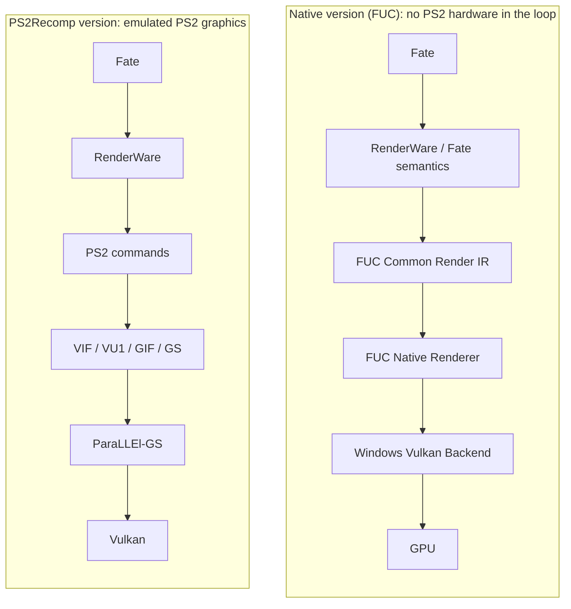

> This repository contains **no game files and no code**: only the project's description and its progress figures.
> The PSP-based version remains at [fuc-recomp](https://github.com/elprogramadorloco-arch/fuc-recomp).

<!-- fuc-observer:progress:start -->
## Progress

**🟦 Currently being worked on:** IQ-004 · LT01 — 23 effect programs (outlined in blue below).

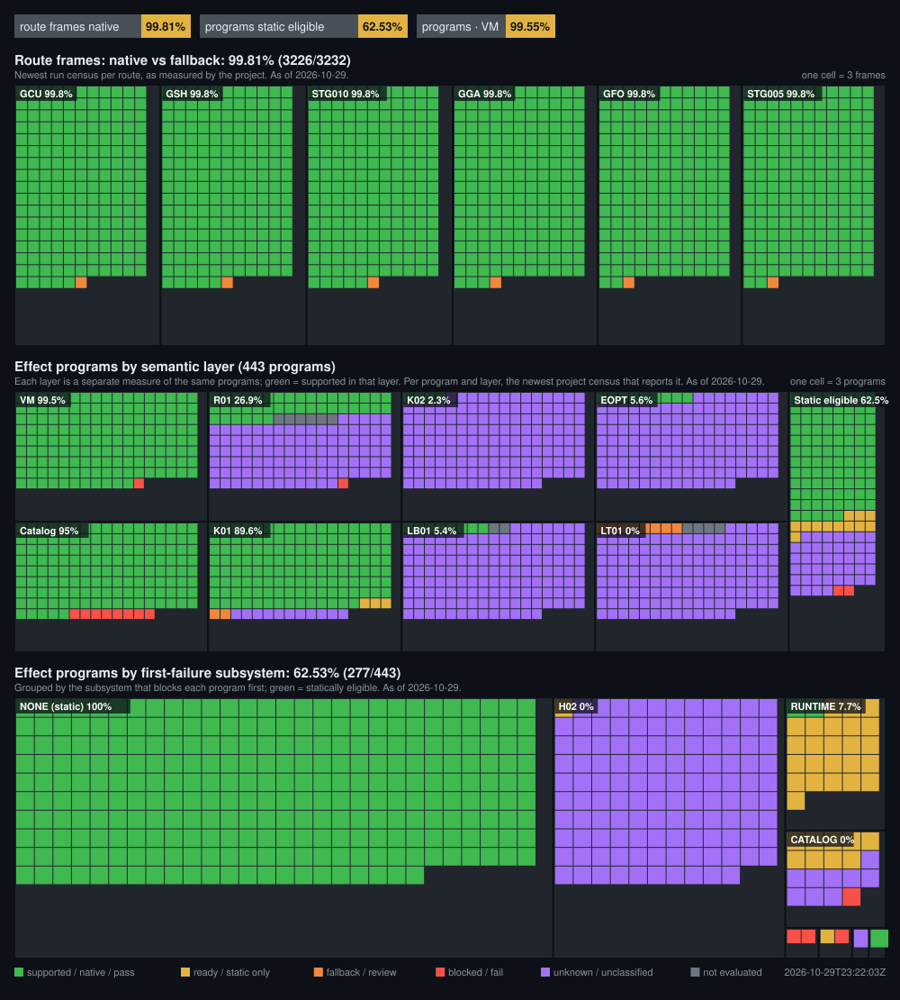

### Effect programs by layer

Click a layer to open its map: the same programs grouped by first-failure subsystem and coloured by that layer (blue border = current work). Each percentage counts only the programs that layer applies to; the others are grey (not applicable) and are listed apart.

<b>VM</b> · 99.55% (441/443)

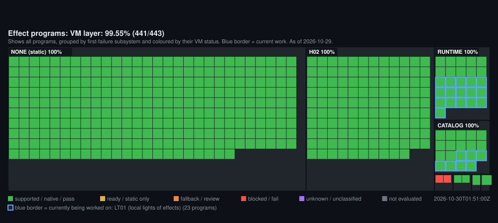

<b>Catalog</b> · 97.52% (432/443)

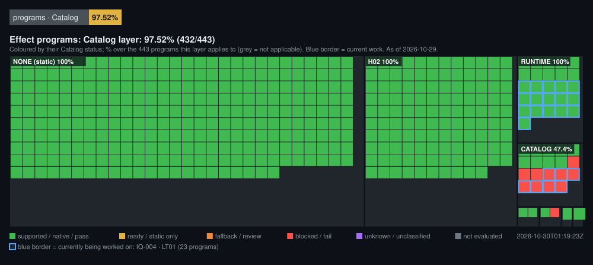

<b>R01</b> · 95.97% (119/124 · 319 not applicable)

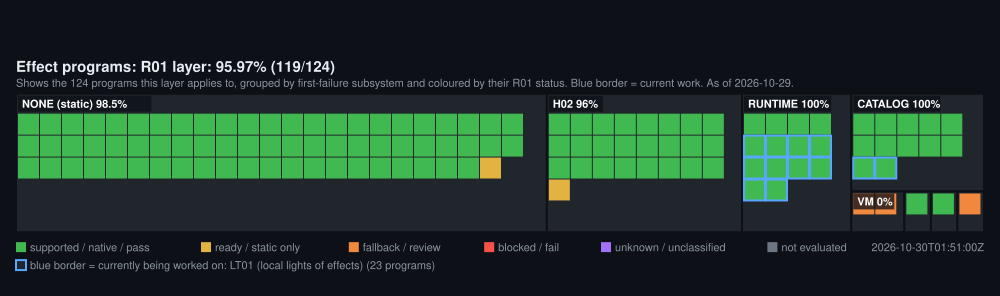

<b>K01</b> · 89.62% (397/443)

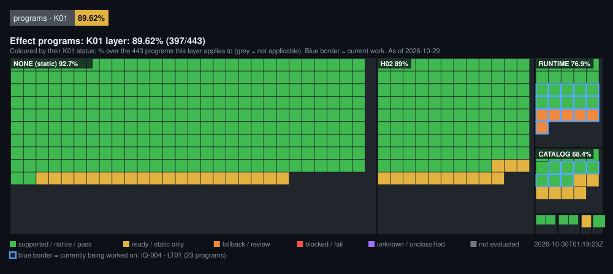

<b>K02</b> · 0.00% (0/10 · 433 not applicable)

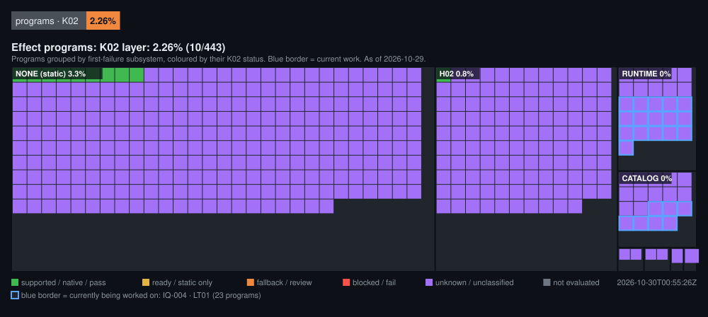

<b>LB01</b> · 70.59% (24/34 · 409 not applicable)

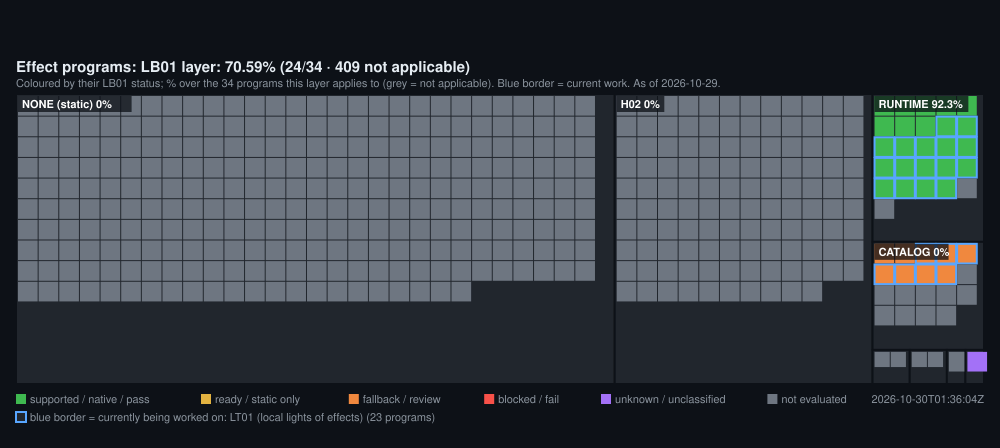

<b>EOPT</b> · 100.00% (25/25 · 418 not applicable)

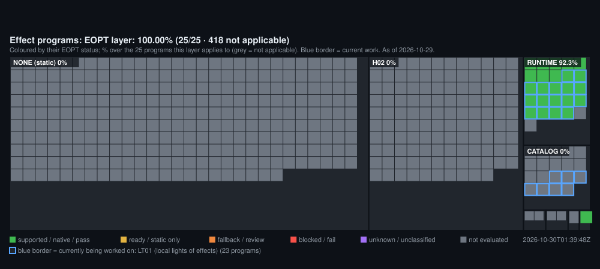

<b>LT01</b> · 0.00% (0/23 · 420 not applicable)

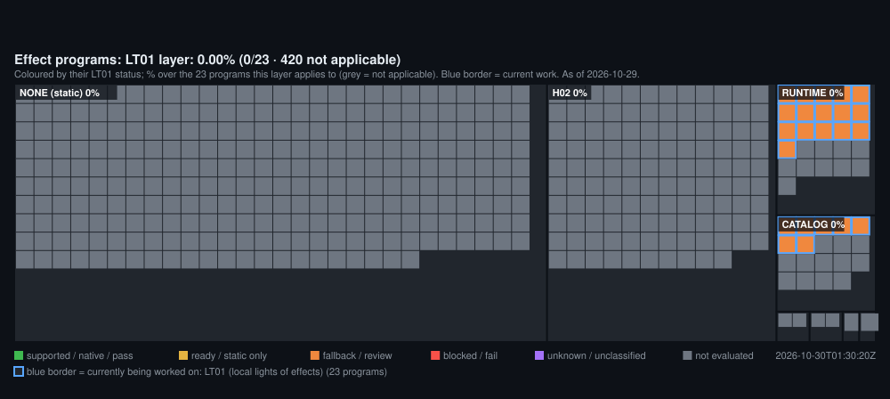

<b>Static eligible</b> · 62.53% (277/443)

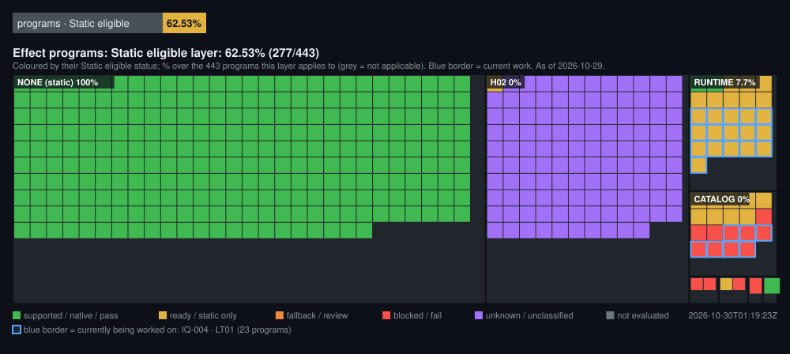

| Figure | Value | As of |
|---|---|---|
| Route frames native | 3227 / 3233 (99.81 %) | 2026-10-30 |
| Effect programs statically eligible | 277 / 443 (62.53 %) | 2026-10-29 |
| Unknown closure | 41 / 128 (32.03 %) | 2026-10-29 |
| Effect VM semantic support | 441 / 443 (99.55 %) | 2026-10-29 |
| Catalog support | 432 / 443 (97.52 %) | 2026-10-29 |
| Regression tests passing | 379 / 379 (100.00 %) | 2026-10-29 |
| Frozen milestones | 76 | 2026-10-29 |

### How to read the panels

Each panel is a treemap: every large box is a group whose **area is proportional to how many items it holds**, and
every small square is one item (or a fixed number of items, noted as "one cell = N"), coloured by its state:

| Colour | Meaning |
|---|---|
| 🟩 green | supported / native / pass |
| 🟨 yellow | ready or static only (not yet proven at run time) |
| 🟧 orange | fallback / needs review |
| 🟥 red | blocked / fail |
| 🟪 purple | unknown or not classified by the project's data |
| ⬜ grey | not evaluated |
| 🟦 blue border | **what the project is working on right now** (derived from the coordinator's active milestone) |

The percentage in each label is the share of green squares in that box. The chips at the top summarise the panels.
Squares and boxes **outlined in blue are what is currently being worked on**; the line above the image names it.

**1. Route frames: native vs fallback.** Each box is a measured game route (a fixed sequence the project runs, e.g.
GSH, GCU, GGA). Squares are frames from the newest run of that route: green frames were drawn entirely by the native
renderer, orange frames fell back to the legacy path. This is the most direct measure of run-time progress. The squares
show proportions, not the order of the frames.

**2. Effect programs by layer (the drop-downs below the image).** Each layer opens its own map of the same effect
programs, grouped by first-failure subsystem. Every layer measures the programs against a
different layer of the port (VM semantics, resource catalog, element registers R01, K01/K02 persistence, late binding
LB01, end-of-pass texture rule EOPT, local lights LT01, and static eligibility). The layers are independent, so they are
never added together; a program is only fully native when every layer it needs is green. Purple usually means that a
layer was never evaluated for that program, not that it failed. Per program and layer, the newest project census that
reports it is used.

**3. Effect programs by first-failure subsystem.** The same programs, grouped by the subsystem that blocks each one
first (NONE = no static blocker left). Green squares are programs that are statically eligible for the native path.
The biggest non-green box is the subsystem whose fix would unlock the most programs.

**4. Regression tests.** One square per test of the newest regression run, grouped by suite (effects VM, frozen
guards, renderer, catalog…): green = passing, red = failing. It shows that what already works keeps working.

**Table.** Headline figures exactly as the project records them (catalog completeness, VM semantic support, closed
unknowns, regression tests, frozen milestones). When a figure appears both here and in a panel, the table is
authoritative: some milestones publish totals without updating every program.

_Updated 2026-10-30T01:19:23Z. Aggregate figures only (counts and percentages recorded by the project's own artifacts), exported by FUC Observer. No game data, file names or paths are published. The per-program layer panel composes the newest project census per program; where a milestone published only totals, the table above is authoritative. Raw data: [progress.json](progress.json)._
<!-- fuc-observer:progress:end -->

---

## English

### Development status

The native PS2 port is in active development. There is **no public build yet**: this repository only publishes the
project's description and its progress, which is exported automatically from the project's own records (see
**Progress** above). When the port is ready, releases will be announced here.

The PSP-based Windows version, with its build instructions and releases, remains available at
[fuc-recomp](https://github.com/elprogramadorloco-arch/fuc-recomp) and is not affected by this repository.

### What is this project?

FUC (*Fate/unlimited codes*) Community tracks a native Windows version of the PS2 release of the game. The goal is a
build that runs the original game's own logic as native code, with no emulator, no PS2 hardware model and no PS2
software in the loop.

- **Static recompilation.** The game's executable is translated ahead of time into native code with **PS2Recomp**
  (an open-source static recompiler, GPLv3), so the original game logic runs as compiled code instead of being
  interpreted.
- **Native rendering.** Frames are drawn by a native renderer that reproduces what the game asks for: models, stages,
  fighters, effects, lights and fog. The original PS2 graphics path is **not part of the final version: it is being
  removed completely**. During development it is still used temporarily only for the few frames that are not yet
  native, and it is deleted part by part as each one is rebuilt.
- **Fully native and safe.** The final version draws everything natively, with **no alternative path at all**: no PS2
  graphics and no fallback mechanism. Safety does not come from falling back to PS2; it comes from proving that every
  part matches the original game's behaviour before it is accepted, so nothing is guessed. During development, what is
  not yet proven still uses the PS2 path temporarily; that mechanism disappears together with the PS2 path.
- **Semantic recovery.** Each subsystem (the effect virtual machine, resource catalogs, material and texture state,
  late-bound resources, local lights, colour and fog rules…) is reconstructed from the game's own behaviour and only
  then made native.
- **Verification.** Results are checked against the original game's behaviour, using PCSX2 as a read-only reference,
  and by large regression suites. Finished work is frozen and protected by guards so later work cannot alter it.

### Native pipeline explained

A plain PS2 recompilation still emulates the console's graphics hardware: the game's RenderWare calls become PS2
commands that pass through emulated **VIF / VU1 / GIF / GS** and a GS renderer (**ParaLLEl-GS**) that runs on Vulkan.
The native version removes that whole layer: it takes what the game *means* (RenderWare and Fate's own semantics),
translates it into the **FUC Common Render IR** and draws it with the **FUC Native Renderer** through a **Windows Vulkan
backend**, straight to the GPU. **The goal is to delete the PS2 graphics path completely.** Until it is gone it only
covers the frames that are not yet native, and the "Route frames native" figure measures how much of the game already
runs without it (diagram above).

### Why a 100% native version

- **Faster and lighter.** Without emulating the PS2 graphics chips (VIF, VU1, GIF, GS) the game no longer pays for
  translating every frame through a model of the console, so it needs far less CPU and GPU and runs on more modest PCs.
- **Real high resolution.** Scenes are drawn by a modern renderer from what the game means, not by enlarging a PS2
  image, so higher resolutions, widescreen and smoother edges become possible at full quality.
- **Faithful to the original.** The game's own logic is kept (statically recompiled), and every native part is proven
  to behave like the original game before it is accepted, so gameplay, timing and visuals stay the same.
- **Stable.** No emulator timing tricks or hardware-specific hacks: the game runs as a normal Windows program on a
  standard Vulkan driver.
- **Open to improvements.** Once nothing depends on PS2 hardware, features that are impossible or awkward on an
  emulated console (texture packs, mods, better effects, new graphics options) can be added on top of a clean base.
- **Preservation.** The game can keep running on modern computers without the original console and without an
  emulator in between.

### How to read the progress

- **Route frames native** is the most direct measure: the share of frames of real battles drawn entirely by the native
  renderer.
- **Effect programs** shows how many of the game's visual effect programs are supported layer by layer (VM semantics,
  catalog, persistence rules, late binding, lights) and what blocks the rest.
- **Regression tests** shows that what already works keeps working.
- Squares and boxes **outlined in blue** are what the project is **working on right now** (the current milestone,
  its subsystem and the effect programs it affects).
- The colour legend and panel guide are in the **Progress** section above. All figures are aggregates (counts and
  percentages); no game data is published.

### Requirements

None yet: there is nothing to download. When a build is released, it will require your own lawfully obtained copy of
the PS2 game, and the private build will be generated locally from it, as with the PSP version.

### Roadmap

| Step | Status | Note |
| --- | --- | --- |
| Static recompilation of the game executable | In progress | Boots and runs the measured battle routes as native code. |
| Native renderer for battles | In progress | See "Route frames native" above; the few remaining frames still use the PS2 path temporarily. |
| Effect programs (VM, catalog, persistence, lights) | In progress | Tracked program by program in the Progress panels. |
| Menus, loading screens and other scenes | In progress | Covered progressively after battles. |
| Complete removal of the PS2 graphics path | Planned (goal) | The final version will contain neither it nor any fallback: both are deleted once every route is 100% native. |
| Public build and instructions | Planned | Only when everything is ready; it will be announced here. |

### Legal notice

This is an interoperability and preservation project and this text is not legal advice. It is not affiliated with or
endorsed by Capcom, Type-Moon, Cavia, Sony, or any other rightsholder. All trademarks and copyrighted game material
belong to their respective owners.

This repository does not and will not contain or redistribute game discs or images, executables, BIOS files, extracted
game files, audio, video, textures, models, fonts, save data, generated recompiled code or any build incorporating
game-derived code. The project works only with the user's own legitimately obtained copy; owning a copy does not grant
redistribution rights. PS2Recomp is GPLv3 and keeps its own license and notices. PCSX2 is used only as a read-only
reference for verification and is not part of the project.

---

## Español

### Estado del desarrollo

El port nativo de la versión de PS2 está en desarrollo activo. **Todavía no hay una versión pública**: este repositorio
solo publica la descripción del proyecto y su progreso, que se exporta automáticamente desde los propios registros del
proyecto (ver **Progress** arriba). Cuando el port esté listo, las versiones se anunciarán aquí.

La versión para Windows basada en PSP, con sus instrucciones y releases, sigue disponible en
[fuc-recomp](https://github.com/elprogramadorloco-arch/fuc-recomp) y este repositorio no la afecta.

### ¿Qué es este proyecto?

FUC (*Fate/unlimited codes*) Community sigue el desarrollo de una versión nativa para Windows de la edición de PS2 del
juego. El objetivo es una versión que ejecute la lógica original del juego como código nativo, sin emulador, sin un
modelo del hardware de PS2 y sin software de PS2 de por medio.

- **Recompilación estática.** El ejecutable del juego se traduce por adelantado a código nativo con **PS2Recomp**
  (un recompilador estático de código abierto, GPLv3), de modo que la lógica original se ejecuta como código compilado
  en lugar de interpretarse.
- **Renderizado nativo.** Los fotogramas los dibuja un renderizador nativo que reproduce lo que el juego pide: modelos,
  escenarios, luchadores, efectos, luces y niebla. El camino gráfico original de PS2 **no forma parte de la versión
  final: se está eliminando por completo**. Durante el desarrollo todavía se usa de forma temporal solo para los pocos
  fotogramas que aún no son nativos, y se va borrando parte por parte a medida que cada una se reconstruye.
- **Totalmente nativo y seguro.** La versión final lo dibuja todo de forma nativa, **sin ningún camino alternativo**:
  ni gráficos de PS2 ni mecanismo de respaldo. La seguridad no viene de volver a PS2, sino de demostrar que cada parte
  coincide con el comportamiento original del juego antes de darla por buena, así que no se adivina nada. Durante el
  desarrollo, lo que aún no está demostrado usa temporalmente el camino de PS2; ese mecanismo desaparece junto con él.
- **Recuperación semántica.** Cada subsistema (la máquina virtual de efectos, los catálogos de recursos, el estado de
  materiales y texturas, los recursos enlazados tarde, las luces locales, las reglas de color y niebla…) se reconstruye
  a partir del comportamiento del propio juego y solo entonces pasa a ser nativo.
- **Verificación.** Los resultados se comparan con el comportamiento del juego original, usando PCSX2 como referencia
  de solo lectura, y con grandes baterías de pruebas de regresión. El trabajo terminado se congela y queda protegido
  por guardas para que el trabajo posterior no pueda alterarlo.

### Versión PS2Recomp frente a versión nativa

Una recompilación de PS2 sin más sigue emulando el hardware gráfico de la consola: las llamadas de RenderWare del juego
se convierten en comandos de PS2 que pasan por **VIF / VU1 / GIF / GS** emulados y por un renderizador de GS
(**ParaLLEl-GS**) que funciona sobre Vulkan. La versión nativa elimina toda esa capa: toma lo que el juego *quiere decir*
(la semántica de RenderWare y de Fate), lo traduce al **FUC Common Render IR** y lo dibuja con el **FUC Native Renderer**
a través de un **backend Vulkan para Windows**, directamente en la GPU. **El objetivo es borrar por completo el camino
gráfico de PS2.** Hasta que desaparezca, solo cubre los fotogramas que aún no son nativos, y la cifra "Route frames
native" mide cuánto del juego ya funciona sin él (diagrama arriba).

### Ventajas de una versión 100% nativa

- **Más rápida y más ligera.** Sin emular los chips gráficos de PS2 (VIF, VU1, GIF, GS), el juego ya no tiene que
  traducir cada fotograma a través de un modelo de la consola, así que necesita mucho menos CPU y GPU y funciona en
  PCs más modestos.
- **Alta resolución real.** Las escenas las dibuja un renderizador moderno a partir de lo que el juego quiere decir, no
  ampliando una imagen de PS2, así que resoluciones altas, pantalla panorámica y bordes más suaves son posibles con
  calidad completa.
- **Fiel al original.** Se conserva la lógica propia del juego (recompilada estáticamente) y cada parte nativa se
  demuestra igual al juego original antes de aceptarla, así que la jugabilidad, los tiempos y el aspecto se mantienen.
- **Estable.** Sin trucos de sincronización de emulador ni parches específicos de hardware: el juego funciona como un
  programa normal de Windows sobre un controlador Vulkan estándar.
- **Abierta a mejoras.** Cuando nada depende del hardware de PS2, se pueden añadir sobre una base limpia funciones que
  en una consola emulada son imposibles o difíciles (packs de texturas, mods, mejores efectos, nuevas opciones gráficas).
- **Preservación.** El juego puede seguir funcionando en ordenadores modernos sin la consola original y sin un emulador
  de por medio.

### Cómo leer el progreso

- **Route frames native** es la medida más directa: el porcentaje de fotogramas de combates reales que dibuja por
  completo el renderizador nativo.
- **Effect programs** muestra cuántos programas de efectos visuales del juego están soportados capa por capa (semántica
  de la VM, catálogo, reglas de persistencia, enlace tardío, luces) y qué bloquea al resto.
- **Regression tests** muestra que lo que ya funciona sigue funcionando.
- Los cuadrados y recuadros **con borde azul** son aquello en lo que el proyecto **está trabajando ahora mismo** (el
  hito actual, su subsistema y los programas de efectos a los que afecta).
- La leyenda de colores y la guía de los paneles están en la sección **Progress** de arriba. Todas las cifras son
  agregadas (conteos y porcentajes); no se publica ningún dato del juego.

### Requisitos

Por ahora ninguno: no hay nada que descargar. Cuando se publique una versión, hará falta tu propia copia legítima del
juego de PS2 y la versión privada se generará localmente a partir de ella, igual que con la versión de PSP.

### Mapa de ruta

| Paso | Estado | Nota |
| --- | --- | --- |
| Recompilación estática del ejecutable del juego | En curso | Arranca y ejecuta como código nativo las rutas de combate medidas. |
| Renderizador nativo para los combates | En curso | Ver "Route frames native" arriba; los pocos fotogramas restantes aún usan el camino de PS2 de forma temporal. |
| Programas de efectos (VM, catálogo, persistencia, luces) | En curso | Se siguen programa a programa en los paneles de Progress. |
| Menús, pantallas de carga y otras escenas | En curso | Se cubren progresivamente después de los combates. |
| Eliminación completa del camino gráfico de PS2 | Previsto (objetivo) | La versión final no tendrá ni ese camino ni ningún respaldo: ambos se borran cuando todas las rutas sean 100% nativas. |
| Versión pública e instrucciones | Previsto | Solo cuando todo esté listo; se anunciará aquí. |

### Aviso legal

Este es un proyecto de interoperabilidad y preservación, y este texto no es asesoramiento legal. No está afiliado ni
respaldado por Capcom, Type-Moon, Cavia, Sony ni ningún otro titular de derechos. Todas las marcas y el material del
juego protegido por derechos de autor pertenecen a sus respectivos propietarios.

Este repositorio no contiene ni contendrá ni redistribuirá discos o imágenes del juego, ejecutables, BIOS, archivos
extraídos del juego, audio, vídeo, texturas, modelos, fuentes, partidas guardadas, código recompilado generado ni
ninguna versión que incorpore código derivado del juego. El proyecto trabaja solo con la copia propia y legítima del
usuario; tener una copia no concede derechos de redistribución. PS2Recomp es GPLv3 y conserva su propia licencia y
avisos. PCSX2 se usa solo como referencia de solo lectura para verificar y no forma parte del proyecto.

---

## Português

### Estado do desenvolvimento

O port nativo da versão de PS2 está em desenvolvimento ativo. **Ainda não há uma versão pública**: este repositório
publica apenas a descrição do projeto e o seu progresso, exportado automaticamente a partir dos próprios registros do
projeto (veja **Progress** acima). Quando o port estiver pronto, as versões serão anunciadas aqui.

A versão para Windows baseada no PSP, com as suas instruções e releases, continua disponível em
[fuc-recomp](https://github.com/elprogramadorloco-arch/fuc-recomp) e não é afetada por este repositório.

### O que é este projeto?

FUC (*Fate/unlimited codes*) Community acompanha o desenvolvimento de uma versão nativa para Windows da edição de PS2
do jogo. O objetivo é uma versão que execute a lógica original do jogo como código nativo, sem emulador, sem um modelo
do hardware do PS2 e sem software do PS2 no meio.

- **Recompilação estática.** O executável do jogo é traduzido antecipadamente para código nativo com o **PS2Recomp**
  (um recompilador estático de código aberto, GPLv3), de modo que a lógica original é executada como código compilado
  em vez de ser interpretada.
- **Renderização nativa.** Os quadros são desenhados por um renderizador nativo que reproduz o que o jogo pede:
  modelos, cenários, lutadores, efeitos, luzes e névoa. O caminho gráfico original do PS2 **não faz parte da versão
  final: está sendo eliminado por completo**. Durante o desenvolvimento ainda é usado de forma temporária apenas para
  os poucos quadros que ainda não são nativos, e vai sendo apagado parte por parte à medida que cada uma é reconstruída.
- **Totalmente nativo e seguro.** A versão final desenha tudo de forma nativa, **sem nenhum caminho alternativo**: nem
  gráficos do PS2 nem mecanismo de reserva. A segurança não vem de voltar ao PS2, mas de provar que cada parte coincide
  com o comportamento original do jogo antes de ser aceita, então nada é adivinhado. Durante o desenvolvimento, o que
  ainda não está provado usa temporariamente o caminho do PS2; esse mecanismo desaparece junto com ele.
- **Recuperação semântica.** Cada subsistema (a máquina virtual de efeitos, os catálogos de recursos, o estado de
  materiais e texturas, os recursos ligados tardiamente, as luzes locais, as regras de cor e névoa…) é reconstruído a
  partir do comportamento do próprio jogo e só então passa a ser nativo.
- **Verificação.** Os resultados são comparados com o comportamento do jogo original, usando o PCSX2 como referência
  somente leitura, e com grandes baterias de testes de regressão. O trabalho concluído é congelado e protegido por
  verificações para que o trabalho posterior não possa alterá-lo.

### Versão PS2Recomp versus versão nativa

Uma recompilação simples do PS2 continua emulando o hardware gráfico do console: as chamadas de RenderWare do jogo
viram comandos do PS2 que passam por **VIF / VU1 / GIF / GS** emulados e por um renderizador de GS (**ParaLLEl-GS**)
que funciona sobre Vulkan. A versão nativa elimina toda essa camada: pega o que o jogo *quer dizer* (a semântica do
RenderWare e do Fate), traduz para o **FUC Common Render IR** e desenha com o **FUC Native Renderer** por meio de um
**backend Vulkan para Windows**, direto na GPU. **O objetivo é apagar por completo o caminho gráfico do PS2.** Até
ele desaparecer, cobre apenas os quadros que ainda não são nativos, e o número "Route frames native" mede quanto do
jogo já funciona sem ele (diagrama acima).

### Vantagens de uma versão 100% nativa

- **Mais rápida e mais leve.** Sem emular os chips gráficos do PS2 (VIF, VU1, GIF, GS), o jogo não precisa mais
  traduzir cada quadro por meio de um modelo do console, então precisa de muito menos CPU e GPU e roda em PCs mais
  modestos.
- **Alta resolução de verdade.** As cenas são desenhadas por um renderizador moderno a partir do que o jogo quer dizer,
  e não ampliando uma imagem do PS2, então resoluções altas, tela widescreen e bordas mais suaves são possíveis com
  qualidade total.
- **Fiel ao original.** A lógica do próprio jogo é mantida (recompilada estaticamente) e cada parte nativa é provada
  igual ao jogo original antes de ser aceita, então a jogabilidade, os tempos e o visual continuam os mesmos.
- **Estável.** Sem truques de sincronização de emulador nem gambiarras de hardware: o jogo roda como um programa normal
  do Windows sobre um driver Vulkan padrão.
- **Aberta a melhorias.** Quando nada depende do hardware do PS2, recursos impossíveis ou difíceis num console emulado
  (pacotes de texturas, mods, efeitos melhores, novas opções gráficas) podem ser adicionados sobre uma base limpa.
- **Preservação.** O jogo pode continuar rodando em computadores modernos sem o console original e sem um emulador no
  meio.

### Como ler o progresso

- **Route frames native** é a medida mais direta: a porcentagem de quadros de combates reais desenhados inteiramente
  pelo renderizador nativo.
- **Effect programs** mostra quantos programas de efeitos visuais do jogo são suportados camada por camada (semântica
  da VM, catálogo, regras de persistência, ligação tardia, luzes) e o que bloqueia o restante.
- **Regression tests** mostra que o que já funciona continua funcionando.
- Os quadrados e caixas **com borda azul** são aquilo em que o projeto **está trabalhando agora** (o marco atual, o
  seu subsistema e os programas de efeitos que ele afeta).
- A legenda de cores e o guia dos painéis estão na seção **Progress** acima. Todos os números são agregados (contagens
  e porcentagens); nenhum dado do jogo é publicado.

### Requisitos

Por enquanto nenhum: não há nada para baixar. Quando uma versão for publicada, será necessária a sua própria cópia
legítima do jogo de PS2, e a versão privada será gerada localmente a partir dela, como na versão de PSP.

### Roteiro

| Etapa | Estado | Nota |
| --- | --- | --- |
| Recompilação estática do executável do jogo | Em andamento | Inicia e executa como código nativo as rotas de combate medidas. |
| Renderizador nativo para os combates | Em andamento | Veja "Route frames native" acima; os poucos quadros restantes ainda usam o caminho do PS2 de forma temporária. |
| Programas de efeitos (VM, catálogo, persistência, luzes) | Em andamento | Acompanhados programa a programa nos painéis de Progress. |
| Menus, telas de carregamento e outras cenas | Em andamento | Cobertos progressivamente depois dos combates. |
| Eliminação completa do caminho gráfico do PS2 | Planejado (objetivo) | A versão final não terá nem esse caminho nem nenhuma reserva: ambos são apagados quando todas as rotas forem 100% nativas. |
| Versão pública e instruções | Planejado | Apenas quando tudo estiver pronto; será anunciado aqui. |

### Aviso legal

Este é um projeto de interoperabilidade e preservação, e este texto não é aconselhamento jurídico. Não é afiliado nem
endossado pela Capcom, Type-Moon, Cavia, Sony ou qualquer outro titular de direitos. Todas as marcas e o material do
jogo protegido por direitos autorais pertencem aos seus respectivos proprietários.

Este repositório não contém nem conterá nem redistribuirá discos ou imagens do jogo, executáveis, BIOS, arquivos
extraídos do jogo, áudio, vídeo, texturas, modelos, fontes, dados salvos, código recompilado gerado ou qualquer versão
que incorpore código derivado do jogo. O projeto trabalha apenas com a cópia própria e legítima do usuário; possuir uma
cópia não concede direitos de redistribuição. O PS2Recomp é GPLv3 e mantém a sua própria licença e avisos. O PCSX2 é
usado apenas como referência somente leitura para verificação e não faz parte do projeto.
