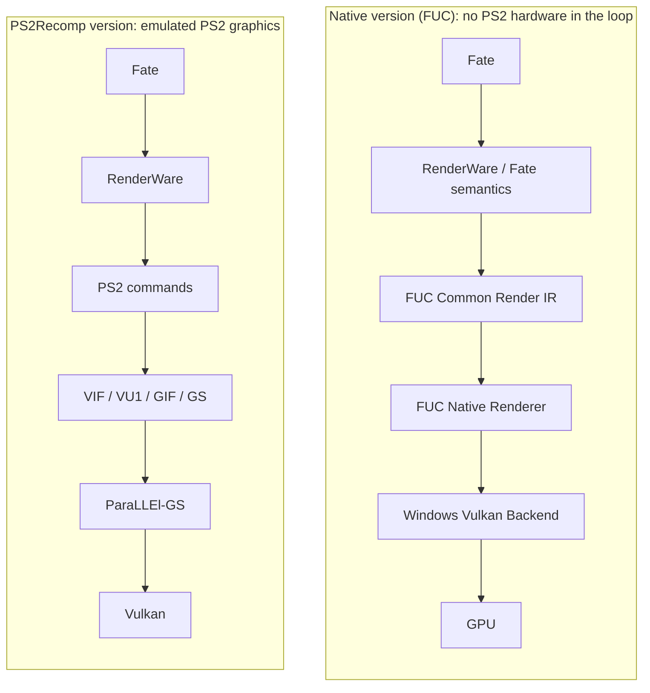

# FUC Community — Fate/unlimited codes, 100% native

[English](#english) · [Español](#español) · [Português](#português)

**EN** — A 100% native Windows version of the PS2 release of *Fate/unlimited codes*: the game's own code,
statically recompiled, with a native renderer that does not depend on PS2 hardware or software.

**ES** — Una versión nativa al 100% para Windows de la edición de PS2 de *Fate/unlimited codes*: el código del propio
juego, recompilado estáticamente, con un renderizador nativo que no depende del hardware ni del software de PS2.

**PT** — Uma versão 100% nativa para Windows da edição de PS2 de *Fate/unlimited codes*: o código do próprio jogo,
recompilado estaticamente, com um renderizador nativo que não depende do hardware nem do software do PS2.

## PS2Recomp version vs native version

> This repository contains **no game files and no code**: only the project's description and its progress figures.
> The PSP-based version remains at [fuc-recomp](https://github.com/elprogramadorloco-arch/fuc-recomp).

<!-- fuc-observer:progress:start -->
## Progress

**🟦 Currently being worked on:** LT01 (local lights of effects) — 23 effect programs (outlined in blue below).

### Effect programs by layer

Click a layer to open its map: the same programs grouped by first-failure subsystem and coloured by that layer (blue border = current work). Each percentage counts only the programs that layer applies to.

<b>VM</b> · 99.55% (441/443)

<b>Catalog</b> · 97.52% (432/443)

<b>R01</b> · 95.97% (119/124)

<b>K01</b> · 89.62% (397/443)

<b>K02</b> · 0.00% (0/10)

<b>LB01</b> · 70.59% (24/34)

<b>EOPT</b> · 100.00% (25/25)

<b>LT01</b> · 0.00% (0/23)

<b>Static eligible</b> · 62.53% (277/443)

| Figure | Value | As of |
|---|---|---|
| Route frames native | 3227 / 3233 (99.81 %) | 2026-10-30 |
| Effect programs statically eligible | 277 / 443 (62.53 %) | 2026-10-29 |
| Effect VM semantic support | 441 / 443 (99.55 %) | 2026-10-29 |
| Catalog support | 432 / 443 (97.52 %) | 2026-10-29 |
| Regression tests passing | 379 / 379 (100.00 %) | 2026-10-29 |

### How to read the panels

Each panel is a treemap: a large box is a group whose **area is proportional to its number of items**, and each small
square is one item (or N items, noted as "one cell = N"). The percentage on a box is its share of green squares.

| Colour | Meaning |
|---|---|
| 🟩 green | supported / native / pass |
| 🟨 yellow | ready, static only or checked at run time (not yet proven while playing) |
| 🟧 orange | fallback / pending |
| 🟥 red | blocked / fail |
| 🟪 purple | no verdict in the project's data |
| ⬜ grey | not applicable / not evaluated |
| 🟦 blue border | **what is being worked on right now** |

- **Route frames.** One box per measured battle route (e.g. GSH, GCU, GGA); green frames were drawn entirely by the
  native renderer, orange ones still used the PS2 path. The most direct measure of progress while playing.
- **Effect programs by first-failure subsystem.** The game's effect programs grouped by what blocks each one first
  (NONE = nothing left statically); green = statically eligible for the native path.
- **Effect programs by layer** (drop-downs). The same programs measured against one layer of the port at a time (VM,
  catalog, R01 registers, K01/K02 persistence, LB01 late binding, EOPT texture changes, LT01 local lights, static
  eligibility). Layers are independent and never added together; each percentage counts only the programs that layer
  applies to.
- **Table.** Headline figures as the project records them; when a figure also appears in a panel, the table is
  authoritative. *Regression tests passing* shows that what already works keeps working.

_Updated 2026-10-30T01:51:00Z. Aggregate figures only (counts and percentages recorded by the project's own artifacts), exported by FUC Observer. No game data, file names or paths are published. The per-program layer panel composes the newest project census per program; where a milestone published only totals, the table above is authoritative. Raw data: [progress.json](progress.json)._
<!-- fuc-observer:progress:end -->

---

## English

### Development status

The native PS2 port is in active development. There is **no public build yet**: this repository publishes the project's
description and its progress, exported automatically from the project's own records (**Progress** above). Releases will
be announced here. The PSP-based version stays at [fuc-recomp](https://github.com/elprogramadorloco-arch/fuc-recomp).

### What is this project?

A native Windows version of the PS2 release of *Fate/unlimited codes* that runs the game's own logic as native code, with
no emulator, no model of the PS2 hardware and no PS2 software in the loop.

- **Static recompilation.** The game's executable is translated ahead of time into native code with **PS2Recomp**
  (open-source static recompiler, GPLv3).
- **Fully native rendering.** A native renderer draws what the game asks for: models, stages, fighters, effects, lights
  and fog. The final version has **no PS2 graphics path and no fallback of any kind**. While the port is in development,
  the few frames that are not yet native temporarily use the PS2 path; it is deleted part by part as each one is rebuilt.
- **Proven, not guessed.** Each subsystem (effect VM, resource catalogs, material and texture state, late-bound resources,
  local lights, colour and fog rules…) is reconstructed from the game's own behaviour, and a part only becomes native
  once it is proven to match the original game.
- **Verification.** Results are checked against the original game, with PCSX2 as a read-only reference, and by regression
  test suites.

### Native pipeline explained

A plain PS2 recompilation still emulates the console's graphics hardware: the game's RenderWare calls become PS2 commands
that go through emulated **VIF / VU1 / GIF / GS** and a GS renderer (**ParaLLEl-GS**) on Vulkan. The native version
removes that layer: it takes what the game *means* (RenderWare and Fate's own semantics), turns it into the **FUC Common
Render IR** and draws it with the **FUC Native Renderer** through a **Windows Vulkan backend**, straight to the GPU
(diagram above). "Route frames native" measures how much of the game already runs this way.

### Why a 100% native version

- **Faster and lighter:** no emulation of the PS2 graphics chips, so it needs much less CPU and GPU.
- **Real high resolution:** scenes are drawn by a modern renderer, not by enlarging a PS2 image, so higher resolutions,
  widescreen and smoother edges are possible at full quality.
- **Faithful:** the game's own logic is kept and every native part is proven against the original, so gameplay, timing
  and visuals stay the same.
- **Stable:** no emulator timing tricks or hardware hacks; it runs as a normal Windows program on a standard Vulkan driver.
- **Open to improvements:** texture packs, mods, better effects and new graphics options can be built on a clean base.
- **Preservation:** the game keeps running on modern computers without the console or an emulator.

### How to read the progress

- **Route frames native:** share of battle frames drawn entirely by the native renderer (the most direct measure).
- **Effect programs:** the game's visual effect programs, by what blocks them and layer by layer (drop-downs); each layer's
  percentage counts only the programs it applies to.
- **Blue border:** what is being worked on right now.
- The colour legend and the panel guide are in **Progress** above. Only aggregate figures are published; no game data.

### Requirements

None yet: there is nothing to download. A future build will require your own lawfully obtained copy of the PS2 game, and
the private build will be generated locally from it, as with the PSP version.

### Roadmap

| Step | Status | Note |
| --- | --- | --- |
| Static recompilation of the game executable | In progress | Boots and runs the measured battle routes as native code. |
| Native renderer for battles | In progress | See "Route frames native"; the few remaining frames still use the PS2 path temporarily. |
| Effect programs (VM, catalog, persistence, lights) | In progress | Tracked program by program in the Progress panels. |
| Menus, loading screens and other scenes | In progress | Covered progressively after battles. |
| Complete removal of the PS2 graphics path | Planned (goal) | The final version contains neither it nor any fallback. |
| Public build and instructions | Planned | Announced here when everything is ready. |

### Legal notice

This is an interoperability and preservation project and this text is not legal advice. It is not affiliated with or
endorsed by Capcom, Type-Moon, Cavia, Sony, or any other rightsholder. All trademarks and copyrighted game material belong
to their respective owners.

This repository does not and will not contain or redistribute game discs or images, executables, BIOS files, extracted
game files, audio, video, textures, models, fonts, save data, generated recompiled code or any build incorporating
game-derived code. The project works only with the user's own legitimately obtained copy; owning a copy does not grant
redistribution rights. PS2Recomp is GPLv3 and keeps its own license and notices. PCSX2 is used only as a read-only
reference for verification and is not part of the project.

---

## Español

### Estado del desarrollo

El port nativo de la versión de PS2 está en desarrollo activo. **Todavía no hay versión pública**: este repositorio publica
la descripción del proyecto y su progreso, exportado automáticamente desde los propios registros del proyecto (**Progress**
arriba). Las versiones se anunciarán aquí. La versión basada en PSP sigue en
[fuc-recomp](https://github.com/elprogramadorloco-arch/fuc-recomp).

### ¿Qué es este proyecto?

Una versión nativa para Windows de la edición de PS2 de *Fate/unlimited codes* que ejecuta la lógica propia del juego como
código nativo, sin emulador, sin un modelo del hardware de PS2 y sin software de PS2 de por medio.

- **Recompilación estática.** El ejecutable del juego se traduce por adelantado a código nativo con **PS2Recomp**
  (recompilador estático de código abierto, GPLv3).
- **Renderizado totalmente nativo.** Un renderizador nativo dibuja lo que el juego pide: modelos, escenarios, luchadores,
  efectos, luces y niebla. La versión final **no tiene camino gráfico de PS2 ni respaldo de ningún tipo**. Mientras el port
  está en desarrollo, los pocos fotogramas que aún no son nativos usan temporalmente el camino de PS2, que se va borrando
  parte por parte a medida que cada una se reconstruye.
- **Demostrado, no adivinado.** Cada subsistema (máquina virtual de efectos, catálogos de recursos, estado de materiales y
  texturas, recursos enlazados tarde, luces locales, reglas de color y niebla…) se reconstruye a partir del comportamiento
  del propio juego, y una parte solo pasa a ser nativa cuando está demostrado que coincide con el original.
- **Verificación.** Los resultados se comparan con el juego original, usando PCSX2 como referencia de solo lectura, y con
  baterías de pruebas de regresión.

### El camino nativo explicado

Una recompilación de PS2 sin más sigue emulando el hardware gráfico de la consola: las llamadas de RenderWare del juego se
convierten en comandos de PS2 que pasan por **VIF / VU1 / GIF / GS** emulados y por un renderizador de GS (**ParaLLEl-GS**)
sobre Vulkan. La versión nativa elimina esa capa: toma lo que el juego *quiere decir* (la semántica de RenderWare y de Fate),
lo convierte al **FUC Common Render IR** y lo dibuja con el **FUC Native Renderer** a través de un **backend Vulkan para
Windows**, directamente en la GPU (diagrama arriba). "Route frames native" mide cuánto del juego ya funciona así.

### Ventajas de una versión 100% nativa

- **Más rápida y ligera:** sin emular los chips gráficos de PS2, necesita mucho menos CPU y GPU.
- **Alta resolución real:** las escenas las dibuja un renderizador moderno, no se amplía una imagen de PS2, así que
  resoluciones altas, pantalla panorámica y bordes más suaves son posibles con calidad completa.
- **Fiel:** se conserva la lógica propia del juego y cada parte nativa se demuestra igual al original, así que la
  jugabilidad, los tiempos y el aspecto se mantienen.
- **Estable:** sin trucos de sincronización de emulador ni parches de hardware; funciona como un programa normal de Windows
  sobre un controlador Vulkan estándar.
- **Abierta a mejoras:** packs de texturas, mods, mejores efectos y nuevas opciones gráficas sobre una base limpia.
- **Preservación:** el juego sigue funcionando en ordenadores modernos sin la consola ni un emulador.

### Cómo leer el progreso

- **Route frames native:** porcentaje de fotogramas de combate dibujados por completo por el renderizador nativo (la medida
  más directa).
- **Effect programs:** los programas de efectos visuales del juego, según qué los bloquea y capa por capa (desplegables);
  el porcentaje de cada capa cuenta solo los programas a los que aplica.
- **Borde azul:** lo que se está trabajando ahora mismo.
- La leyenda de colores y la guía de los paneles están en **Progress** arriba. Solo se publican cifras agregadas; ningún
  dato del juego.

### Requisitos

Por ahora ninguno: no hay nada que descargar. Una futura versión requerirá tu propia copia legítima del juego de PS2, y la
versión privada se generará localmente a partir de ella, igual que con la versión de PSP.

### Mapa de ruta

| Paso | Estado | Nota |
| --- | --- | --- |
| Recompilación estática del ejecutable del juego | En curso | Arranca y ejecuta como código nativo las rutas de combate medidas. |
| Renderizador nativo para los combates | En curso | Ver "Route frames native"; los pocos fotogramas restantes aún usan el camino de PS2 de forma temporal. |
| Programas de efectos (VM, catálogo, persistencia, luces) | En curso | Se siguen programa a programa en los paneles de Progress. |
| Menús, pantallas de carga y otras escenas | En curso | Se cubren progresivamente después de los combates. |
| Eliminación completa del camino gráfico de PS2 | Previsto (objetivo) | La versión final no tendrá ni ese camino ni ningún respaldo. |
| Versión pública e instrucciones | Previsto | Se anunciará aquí cuando todo esté listo. |

### Aviso legal

Este es un proyecto de interoperabilidad y preservación, y este texto no es asesoramiento legal. No está afiliado ni
respaldado por Capcom, Type-Moon, Cavia, Sony ni ningún otro titular de derechos. Todas las marcas y el material del juego
protegido por derechos de autor pertenecen a sus respectivos propietarios.

Este repositorio no contiene ni contendrá ni redistribuirá discos o imágenes del juego, ejecutables, BIOS, archivos
extraídos del juego, audio, vídeo, texturas, modelos, fuentes, partidas guardadas, código recompilado generado ni ninguna
versión que incorpore código derivado del juego. El proyecto trabaja solo con la copia propia y legítima del usuario; tener
una copia no concede derechos de redistribución. PS2Recomp es GPLv3 y conserva su propia licencia y avisos. PCSX2 se usa
solo como referencia de solo lectura para verificar y no forma parte del proyecto.

---

## Português

### Estado do desenvolvimento

O port nativo da versão de PS2 está em desenvolvimento ativo. **Ainda não há versão pública**: este repositório publica a
descrição do projeto e o seu progresso, exportado automaticamente dos próprios registros do projeto (**Progress** acima).
As versões serão anunciadas aqui. A versão baseada no PSP continua em
[fuc-recomp](https://github.com/elprogramadorloco-arch/fuc-recomp).

### O que é este projeto?

Uma versão nativa para Windows da edição de PS2 de *Fate/unlimited codes* que executa a lógica do próprio jogo como código
nativo, sem emulador, sem um modelo do hardware do PS2 e sem software do PS2 no meio.

- **Recompilação estática.** O executável do jogo é traduzido antecipadamente para código nativo com o **PS2Recomp**
  (recompilador estático de código aberto, GPLv3).
- **Renderização totalmente nativa.** Um renderizador nativo desenha o que o jogo pede: modelos, cenários, lutadores,
  efeitos, luzes e névoa. A versão final **não tem caminho gráfico do PS2 nem reserva de nenhum tipo**. Enquanto o port
  está em desenvolvimento, os poucos quadros que ainda não são nativos usam temporariamente o caminho do PS2, que vai sendo
  apagado parte por parte à medida que cada uma é reconstruída.
- **Provado, não adivinhado.** Cada subsistema (máquina virtual de efeitos, catálogos de recursos, estado de materiais e
  texturas, recursos ligados tardiamente, luzes locais, regras de cor e névoa…) é reconstruído a partir do comportamento do
  próprio jogo, e uma parte só passa a ser nativa quando está provado que coincide com o original.
- **Verificação.** Os resultados são comparados com o jogo original, usando o PCSX2 como referência somente leitura, e com
  baterias de testes de regressão.

### O caminho nativo explicado

Uma recompilação simples do PS2 continua emulando o hardware gráfico do console: as chamadas de RenderWare do jogo viram
comandos do PS2 que passam por **VIF / VU1 / GIF / GS** emulados e por um renderizador de GS (**ParaLLEl-GS**) sobre Vulkan.
A versão nativa elimina essa camada: pega o que o jogo *quer dizer* (a semântica do RenderWare e do Fate), converte para o
**FUC Common Render IR** e desenha com o **FUC Native Renderer** por meio de um **backend Vulkan para Windows**, direto na
GPU (diagrama acima). "Route frames native" mede quanto do jogo já funciona assim.

### Vantagens de uma versão 100% nativa

- **Mais rápida e leve:** sem emular os chips gráficos do PS2, precisa de muito menos CPU e GPU.
- **Alta resolução de verdade:** as cenas são desenhadas por um renderizador moderno, sem ampliar uma imagem do PS2, então
  resoluções altas, widescreen e bordas mais suaves são possíveis com qualidade total.
- **Fiel:** a lógica do próprio jogo é mantida e cada parte nativa é provada igual ao original, então a jogabilidade, os
  tempos e o visual continuam os mesmos.
- **Estável:** sem truques de sincronização de emulador nem gambiarras de hardware; roda como um programa normal do Windows
  sobre um driver Vulkan padrão.
- **Aberta a melhorias:** pacotes de texturas, mods, efeitos melhores e novas opções gráficas sobre uma base limpa.
- **Preservação:** o jogo continua rodando em computadores modernos sem o console nem um emulador.

### Como ler o progresso

- **Route frames native:** porcentagem de quadros de combate desenhados inteiramente pelo renderizador nativo (a medida
  mais direta).
- **Effect programs:** os programas de efeitos visuais do jogo, pelo que os bloqueia e camada por camada (menus
  expansíveis); a porcentagem de cada camada conta apenas os programas aos quais ela se aplica.
- **Borda azul:** o que está sendo trabalhado agora.
- A legenda de cores e o guia dos painéis estão em **Progress** acima. Só são publicados números agregados; nenhum dado do
  jogo.

### Requisitos

Por enquanto nenhum: não há nada para baixar. Uma versão futura vai exigir a sua própria cópia legítima do jogo de PS2, e a
versão privada será gerada localmente a partir dela, como na versão de PSP.

### Roteiro

| Etapa | Estado | Nota |
| --- | --- | --- |
| Recompilação estática do executável do jogo | Em andamento | Inicia e executa como código nativo as rotas de combate medidas. |
| Renderizador nativo para os combates | Em andamento | Veja "Route frames native"; os poucos quadros restantes ainda usam o caminho do PS2 de forma temporária. |
| Programas de efeitos (VM, catálogo, persistência, luzes) | Em andamento | Acompanhados programa a programa nos painéis de Progress. |
| Menus, telas de carregamento e outras cenas | Em andamento | Cobertos progressivamente depois dos combates. |
| Eliminação completa do caminho gráfico do PS2 | Planejado (objetivo) | A versão final não terá nem esse caminho nem nenhuma reserva. |
| Versão pública e instruções | Planejado | Será anunciada aqui quando tudo estiver pronto. |

### Aviso legal

Este é um projeto de interoperabilidade e preservação, e este texto não é aconselhamento jurídico. Não é afiliado nem
endossado pela Capcom, Type-Moon, Cavia, Sony ou qualquer outro titular de direitos. Todas as marcas e o material do jogo
protegido por direitos autorais pertencem aos seus respectivos proprietários.

Este repositório não contém nem conterá nem redistribuirá discos ou imagens do jogo, executáveis, BIOS, arquivos extraídos
do jogo, áudio, vídeo, texturas, modelos, fontes, dados salvos, código recompilado gerado ou qualquer versão que incorpore
código derivado do jogo. O projeto trabalha apenas com a cópia própria e legítima do usuário; possuir uma cópia não concede
direitos de redistribuição. O PS2Recomp é GPLv3 e mantém a sua própria licença e avisos. O PCSX2 é usado apenas como
referência somente leitura para verificação e não faz parte do projeto.
