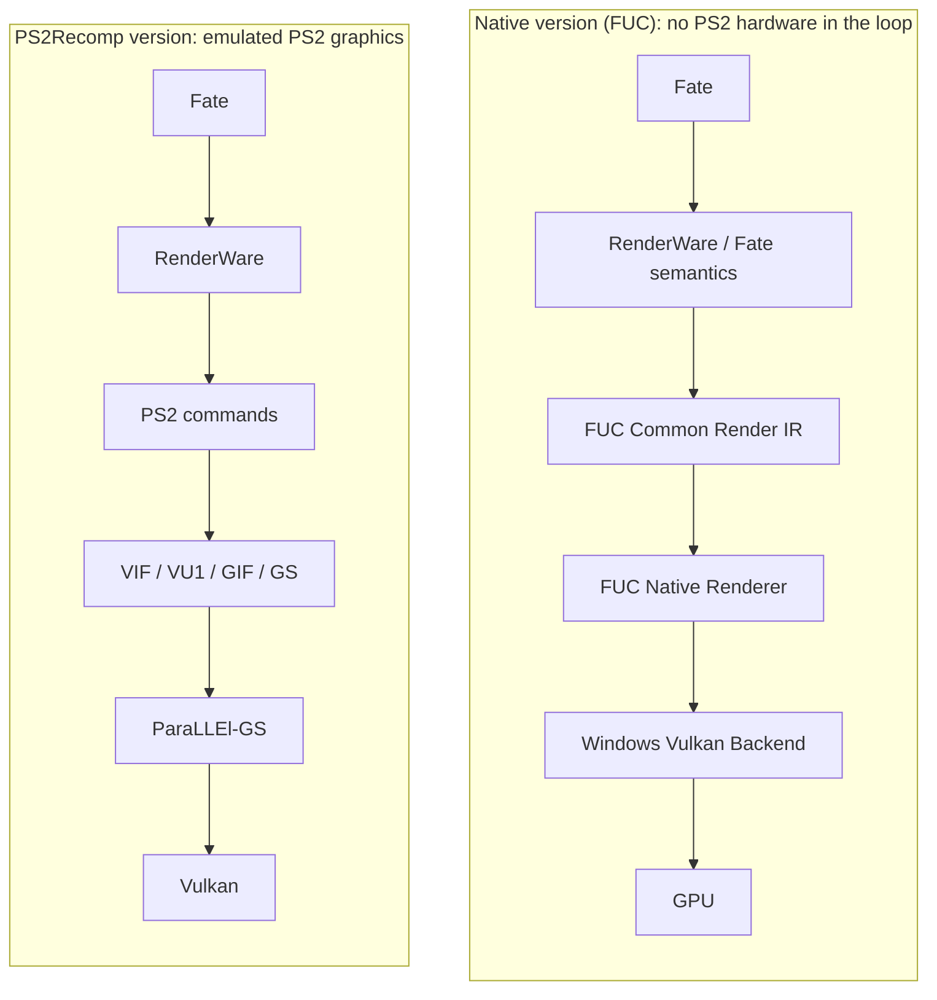

# FUC Community — Fate/unlimited codes, 100% native

[English](#english) · [Español](#español) · [Português](#português)

**EN** — A 100% native Windows version of the PS2 release of *Fate/unlimited codes*: the game's own code,
statically recompiled, with a native renderer that does not depend on PS2 hardware or software.

**ES** — Una versión nativa al 100% para Windows de la edición de PS2 de *Fate/unlimited codes*: el código del propio
juego, recompilado estáticamente, con un renderizador nativo que no depende del hardware ni del software de PS2.

**PT** — Uma versão 100% nativa para Windows da edição de PS2 de *Fate/unlimited codes*: o código do próprio jogo,
recompilado estaticamente, com um renderizador nativo que não depende do hardware nem do software do PS2.

## PS2Recomp version vs native version

> This repository contains **no game files and no code**: only the project's description and its progress figures.
> The PSP-based version remains at [fuc-recomp](https://github.com/elprogramadorloco-arch/fuc-recomp).

<!-- fuc-observer:progress:start -->
## Progress

**⬜ Currently being worked on:** L01 (local lights) · R01 (effect element registers) — 6 effect programs (white outline below).

| At a glance | Value | Over |
|---|---|---|
| Measured battle routes — native frames | 3227 / 3233 (99.81 %) | measured route frames only |
| Effect programs — native coverage | 0 / 443 (0.00 %) | actually executed natively |
| Effect programs — native-ready coverage | 277 / 443 (62.53 %) | native + ready, not seen |
| Effect programs — investigated coverage | 443 / 443 (100.00 %) | everything but untouched |
| Known semantic unknowns | 87 OPEN of 128 | the project's unknown census |

### Game coverage

Only areas with a known inventory get a percentage; the rest say **NOT MEASURED** instead of guessing.

| Area | Status | What is known |
|---|---|---|
| Gameplay / game logic | **NOT MEASURED** | The game code runs recompiled, but no per-function or per-feature native census is recorded. |
| Characters | partly measured | 18 characters · effect programs only: native 0.0 %, native-ready 62.5 %, investigated 100.0 % |
| Stages | **NOT MEASURED** | measured battle routes touch 2 stage IDs |
| Effects | measured | Effect programs · 443 known: native 0.0 %, native-ready 62.5 %, investigated 100.0 % |
| HUD / battle UI | **NOT MEASURED** | No HUD inventory census is recorded. |
| Menus / frontend | **NOT MEASURED** | No menu or frontend inventory census is recorded. |
| FMV / cutscenes | **NOT MEASURED** | No FMV inventory census is recorded. |
| Audio | **NOT MEASURED** | No audio inventory census is recorded. |
| Input | **NOT MEASURED** | No input census is recorded. |
| Save / load | **NOT MEASURED** | No save or load census is recorded. |
| Storage / assets / loading | **NOT MEASURED** | No storage or loading census is recorded. |
| Timing / synchronization | **NOT MEASURED** | No timing census is recorded. |
| Game modes / progression | **NOT MEASURED** | No game-mode census is recorded. |
| Image correctness | **NOT MEASURED** | effect programs: all NOT VALIDATED |
| Performance | **NOT MEASURED** | no supported performance record found |
| Stability | **NOT MEASURED** | no supported stability record found |
| Production integration | **NOT MEASURED** | production baseline: recorded; integration items integrated in research: 8 of 11; promoted to production: not recorded |
| Fallback removal | partly measured | measured route fallback: 6 of 3233 frames; effect-program fallback: 14 of 443 programs; known content fallback: NOT MEASURED |
| Global semantic unknowns | measured | OPEN: 87; closed or deferred: 41; VM support near 100 % does not close them |

### How to read it

Every known item has one state. Today the only complete item census is the game's **effect programs** (the code that
draws visual effects): one square each.

| | State | Meaning | Effect programs |
|---|---|---|---|
| 🟩 | **NATIVE** | executed through the native path with its guards passing | 0 |
| 🟨 | **PARTIAL** | native only under a condition that is not closed yet, or only part of it is native | 35 |
| 🟥 | **FALLBACK** | known and examined, but it still needs the PS2 path | 14 |
| 🟦 | **READY / NOT SEEN** | proven native-ready, but no real run has executed it natively yet | 277 |
| 🟪 | **UNKNOWN** | investigated, but an unresolved question still prevents a verdict | 117 |
| ⬜ | **UNTOUCHED** | known to exist, work has not started | 0 |
| ⬛ | **NOT MEASURED** | no trustworthy inventory or census exists yet |  |
| ⬜ | **white outline** | what is being worked on right now | |

- **Native coverage** counts only items actually executed natively. **Native-ready** adds the ones proven ready but not
  seen running yet. **Investigated** is everything except untouched. The three are never added together.
- **Measured battle routes** count frames of the routes the project measured; they are not whole-game coverage.
- Near-complete effect figures do not mean the whole game is native: most areas are still NOT MEASURED. See *What the
  figures do not measure yet* below.

_Updated 2026-10-30T17:45:56Z. Aggregate figures only, derived from the project's own records by FUC Observer (schema V2). No game data, file names or paths are published. Raw data: [progress.json](progress.json)._
<!-- fuc-observer:progress:end -->

---

## English

### Development status

The native PS2 port is in active development. There is **no public build yet**: this repository publishes the project's
description and its progress, exported automatically from the project's own records (**Progress** above). Releases will
be announced here. The PSP-based version stays at [fuc-recomp](https://github.com/elprogramadorloco-arch/fuc-recomp).

### What is this project?

A native Windows version of the PS2 release of *Fate/unlimited codes* that runs the game's own logic as native code, with
no emulator, no model of the PS2 hardware and no PS2 software in the loop.

- **Static recompilation.** The game's executable is translated ahead of time into native code with **PS2Recomp**
  (open-source static recompiler, GPLv3).
- **Fully native rendering.** A native renderer draws what the game asks for: models, stages, fighters, effects, lights
  and fog. The final version has **no PS2 graphics path and no fallback of any kind**. While the port is in development,
  the few frames that are not yet native temporarily use the PS2 path; it is deleted part by part as each one is rebuilt.
- **Proven, not guessed.** Each subsystem (effect VM, resource catalogs, material and texture state, late-bound resources,
  local lights, colour and fog rules…) is reconstructed from the game's own behaviour, and a part only becomes native
  once it is proven to match the original game.
- **Verification.** Results are checked against the original game, with PCSX2 as a read-only reference, and by regression
  test suites.

### Native pipeline explained

A plain PS2 recompilation still emulates the console's graphics hardware: the game's RenderWare calls become PS2 commands
that go through emulated **VIF / VU1 / GIF / GS** and a GS renderer (**ParaLLEl-GS**) on Vulkan. The native version
removes that layer: it takes what the game *means* (RenderWare and Fate's own semantics), turns it into the **FUC Common
Render IR** and draws it with the **FUC Native Renderer** through a **Windows Vulkan backend**, straight to the GPU
(diagram above). "Measured battle routes" shows how many of the measured battle frames already run this way (not the whole game).

### Why a 100% native version

- **Faster and lighter:** no emulation of the PS2 graphics chips, so it needs much less CPU and GPU.
- **Real high resolution:** scenes are drawn by a modern renderer, not by enlarging a PS2 image, so higher resolutions,
  widescreen and smoother edges are possible at full quality.
- **Faithful:** the game's own logic is kept and every native part is proven against the original, so gameplay, timing
  and visuals stay the same.
- **Stable:** no emulator timing tricks or hardware hacks; it runs as a normal Windows program on a standard Vulkan driver.
- **Open to improvements:** texture packs, mods, better effects and new graphics options can be built on a clean base.
- **Preservation:** the game keeps running on modern computers without the console or an emulator.

### How to read the progress

- **FUC Native Game Coverage:** every known item has one state (NATIVE, PARTIAL, FALLBACK, READY / NOT SEEN, UNKNOWN,
  UNTOUCHED). Only areas with a known inventory get a percentage; the others say NOT MEASURED instead of guessing.
- **Native, native-ready and investigated coverage** are three separate figures: actually executed natively; proven ready
  but not seen running yet; examined at all. They are never added together.
- **Measured battle routes:** share of the measured battle frames drawn entirely by the native renderer. It covers only
  the routes the project measured, not the whole game.
- **Effect programs:** the game's visual effect programs, one square each, grouped by character.
- **White outline:** what is being worked on right now.
- The full legend is in **Progress** above. Only aggregate figures are published; no game data.

### What the figures do not measure yet

Reaching 100 % in the progress figures does **not** mean the game is playable yet. They follow the current phase: moving
scene and effect rendering from the emulated PS2 path to the native renderer. After that, these steps remain:

1. **The whole game.** The battle routes measured so far cover few characters and stages. Every character, stage, menu,
   character select, HUD, super move, ending and game mode (Arcade, Story, Versus, Practice) must also run with no fallback.
2. **Correct image.** "Supported" or "eligible" means the native renderer can run a program, not that its pixels already
   match the original. Each family of effects and scenes is compared against the original game.
3. **Speed.** Every frame must stay comfortably under 16.67 ms (60 fps). Native frames are already far faster than the
   emulated path, but not yet fast enough; leftover emulation work and diagnostic hooks still have to be removed.
4. **Release build.** The newest work has to be promoted into the build that is actually used, validated by regression
   tests and a full route.
5. **Removing the PS2 path.** Only after the steps above is the emulated path deleted for good.
6. **The rest of the game.** The game logic is the original code, recompiled, but real-time audio, controller, legitimate
   save data, loading and long-session stability must be checked end to end.

### Requirements

None yet: there is nothing to download. A future build will require your own lawfully obtained copy of the PS2 game, and
the private build will be generated locally from it, as with the PSP version.

### Roadmap

| Step | Status | Note |
| --- | --- | --- |
| Static recompilation of the game executable | In progress | Boots and runs the measured battle routes as native code. |
| Native renderer for battles | In progress | See "Measured battle routes"; the few remaining measured frames still use the PS2 path temporarily. |
| Effect programs (VM, catalog, persistence, lights) | In progress | Tracked program by program in Progress (one square per program). |
| Menus, loading screens and other scenes | In progress | Covered progressively after battles. |
| Image identical to the original game | In progress | Compared family by family against the original game. |
| Full speed (60 fps on every frame) | In progress | Native frames are much faster than the emulated path, not yet fast enough. |
| Audio, controller, save data, loading, stability | Planned | Checked end to end before any public build. |
| Complete removal of the PS2 graphics path | Planned (goal) | The final version contains neither it nor any fallback. |
| Public build and instructions | Planned | Announced here when everything is ready. |

### Legal notice

This is an interoperability and preservation project and this text is not legal advice. It is not affiliated with or
endorsed by Capcom, Type-Moon, Cavia, Sony, or any other rightsholder. All trademarks and copyrighted game material belong
to their respective owners.

This repository does not and will not contain or redistribute game discs or images, executables, BIOS files, extracted
game files, audio, video, textures, models, fonts, save data, generated recompiled code or any build incorporating
game-derived code. The project works only with the user's own legitimately obtained copy; owning a copy does not grant
redistribution rights. PS2Recomp is GPLv3 and keeps its own license and notices. PCSX2 is used only as a read-only
reference for verification and is not part of the project.

---

## Español

### Estado del desarrollo

El port nativo de la versión de PS2 está en desarrollo activo. **Todavía no hay versión pública**: este repositorio publica
la descripción del proyecto y su progreso, exportado automáticamente desde los propios registros del proyecto (**Progress**
arriba). Las versiones se anunciarán aquí. La versión basada en PSP sigue en
[fuc-recomp](https://github.com/elprogramadorloco-arch/fuc-recomp).

### ¿Qué es este proyecto?

Una versión nativa para Windows de la edición de PS2 de *Fate/unlimited codes* que ejecuta la lógica propia del juego como
código nativo, sin emulador, sin un modelo del hardware de PS2 y sin software de PS2 de por medio.

- **Recompilación estática.** El ejecutable del juego se traduce por adelantado a código nativo con **PS2Recomp**
  (recompilador estático de código abierto, GPLv3).
- **Renderizado totalmente nativo.** Un renderizador nativo dibuja lo que el juego pide: modelos, escenarios, luchadores,
  efectos, luces y niebla. La versión final **no tiene camino gráfico de PS2 ni respaldo de ningún tipo**. Mientras el port
  está en desarrollo, los pocos fotogramas que aún no son nativos usan temporalmente el camino de PS2, que se va borrando
  parte por parte a medida que cada una se reconstruye.
- **Demostrado, no adivinado.** Cada subsistema (máquina virtual de efectos, catálogos de recursos, estado de materiales y
  texturas, recursos enlazados tarde, luces locales, reglas de color y niebla…) se reconstruye a partir del comportamiento
  del propio juego, y una parte solo pasa a ser nativa cuando está demostrado que coincide con el original.
- **Verificación.** Los resultados se comparan con el juego original, usando PCSX2 como referencia de solo lectura, y con
  baterías de pruebas de regresión.

### El camino nativo explicado

Una recompilación de PS2 sin más sigue emulando el hardware gráfico de la consola: las llamadas de RenderWare del juego se
convierten en comandos de PS2 que pasan por **VIF / VU1 / GIF / GS** emulados y por un renderizador de GS (**ParaLLEl-GS**)
sobre Vulkan. La versión nativa elimina esa capa: toma lo que el juego *quiere decir* (la semántica de RenderWare y de Fate),
lo convierte al **FUC Common Render IR** y lo dibuja con el **FUC Native Renderer** a través de un **backend Vulkan para
Windows**, directamente en la GPU (diagrama arriba). "Measured battle routes" muestra cuántos de los fotogramas de combate medidos ya funcionan así (no el juego entero).

### Ventajas de una versión 100% nativa

- **Más rápida y ligera:** sin emular los chips gráficos de PS2, necesita mucho menos CPU y GPU.
- **Alta resolución real:** las escenas las dibuja un renderizador moderno, no se amplía una imagen de PS2, así que
  resoluciones altas, pantalla panorámica y bordes más suaves son posibles con calidad completa.
- **Fiel:** se conserva la lógica propia del juego y cada parte nativa se demuestra igual al original, así que la
  jugabilidad, los tiempos y el aspecto se mantienen.
- **Estable:** sin trucos de sincronización de emulador ni parches de hardware; funciona como un programa normal de Windows
  sobre un controlador Vulkan estándar.
- **Abierta a mejoras:** packs de texturas, mods, mejores efectos y nuevas opciones gráficas sobre una base limpia.
- **Preservación:** el juego sigue funcionando en ordenadores modernos sin la consola ni un emulador.

### Cómo leer el progreso

- **FUC Native Game Coverage:** cada elemento conocido tiene un estado (NATIVE, PARTIAL, FALLBACK, READY / NOT SEEN,
  UNKNOWN, UNTOUCHED). Solo las áreas con inventario conocido tienen porcentaje; las demás dicen NOT MEASURED en vez de
  adivinar.
- **Cobertura nativa, lista e investigada** son tres cifras separadas: ejecutado de verdad en nativo; demostrado listo pero
  aún sin verse en marcha; examinado. Nunca se suman.
- **Measured battle routes:** porcentaje de los fotogramas de combate medidos que dibuja por completo el renderizador
  nativo. Solo cubre las rutas que el proyecto midió, no el juego entero.
- **Effect programs:** los programas de efectos visuales del juego, un cuadrado cada uno, agrupados por personaje.
- **Contorno blanco:** lo que se está trabajando ahora mismo.
- La leyenda completa está en **Progress** arriba. Solo se publican cifras agregadas; ningún dato del juego.

### Lo que las cifras aún no miden

Llegar al 100 % en las cifras de progreso **no** significa que el juego ya se pueda jugar. Siguen la fase actual: pasar el
dibujado de escenas y efectos del camino de PS2 emulado al renderizador nativo. Después quedan estos pasos:

1. **Todo el juego.** Las rutas de combate medidas hasta ahora cubren pocos personajes y escenarios. También tienen que
   funcionar sin respaldo todos los personajes, escenarios, menús, selección de personaje, HUD, supers, finales y modos de
   juego (Arcade, Story, Versus, Practice).
2. **Imagen correcta.** "Soportado" o "elegible" significa que el renderizador nativo sabe ejecutar un programa, no que sus
   píxeles ya coincidan con el original. Cada familia de efectos y escenas se compara con el juego original.
3. **Velocidad.** Cada fotograma tiene que quedar holgadamente por debajo de 16,67 ms (60 fps). Los fotogramas nativos ya son
   mucho más rápidos que el camino emulado, pero todavía no lo suficiente; falta retirar trabajo de emulación heredado y
   ganchos de diagnóstico.
4. **Versión de uso.** El trabajo más reciente tiene que pasar a la versión que realmente se usa, validado con pruebas de
   regresión y una ruta completa.
5. **Retirar el camino de PS2.** Solo después de los pasos anteriores se elimina definitivamente el camino emulado.
6. **El resto del juego.** La lógica es el código original recompilado, pero hay que comprobar de punta a punta el audio a
   tiempo real, el mando, las partidas guardadas legítimas, las cargas y la estabilidad en sesiones largas.

### Requisitos

Por ahora ninguno: no hay nada que descargar. Una futura versión requerirá tu propia copia legítima del juego de PS2, y la
versión privada se generará localmente a partir de ella, igual que con la versión de PSP.

### Mapa de ruta

| Paso | Estado | Nota |
| --- | --- | --- |
| Recompilación estática del ejecutable del juego | En curso | Arranca y ejecuta como código nativo las rutas de combate medidas. |
| Renderizador nativo para los combates | En curso | Ver "Measured battle routes"; los pocos fotogramas medidos restantes aún usan el camino de PS2 de forma temporal. |
| Programas de efectos (VM, catálogo, persistencia, luces) | En curso | Se siguen programa a programa en Progress (un cuadrado por programa). |
| Menús, pantallas de carga y otras escenas | En curso | Se cubren progresivamente después de los combates. |
| Imagen idéntica al juego original | En curso | Se compara familia por familia con el juego original. |
| Velocidad completa (60 fps en todos los fotogramas) | En curso | Los fotogramas nativos ya son mucho más rápidos que el camino emulado, aún no lo suficiente. |
| Audio, mando, partidas guardadas, cargas, estabilidad | Previsto | Se comprueban de punta a punta antes de cualquier versión pública. |
| Eliminación completa del camino gráfico de PS2 | Previsto (objetivo) | La versión final no tendrá ni ese camino ni ningún respaldo. |
| Versión pública e instrucciones | Previsto | Se anunciará aquí cuando todo esté listo. |

### Aviso legal

Este es un proyecto de interoperabilidad y preservación, y este texto no es asesoramiento legal. No está afiliado ni
respaldado por Capcom, Type-Moon, Cavia, Sony ni ningún otro titular de derechos. Todas las marcas y el material del juego
protegido por derechos de autor pertenecen a sus respectivos propietarios.

Este repositorio no contiene ni contendrá ni redistribuirá discos o imágenes del juego, ejecutables, BIOS, archivos
extraídos del juego, audio, vídeo, texturas, modelos, fuentes, partidas guardadas, código recompilado generado ni ninguna
versión que incorpore código derivado del juego. El proyecto trabaja solo con la copia propia y legítima del usuario; tener
una copia no concede derechos de redistribución. PS2Recomp es GPLv3 y conserva su propia licencia y avisos. PCSX2 se usa
solo como referencia de solo lectura para verificar y no forma parte del proyecto.

---

## Português

### Estado do desenvolvimento

O port nativo da versão de PS2 está em desenvolvimento ativo. **Ainda não há versão pública**: este repositório publica a
descrição do projeto e o seu progresso, exportado automaticamente dos próprios registros do projeto (**Progress** acima).
As versões serão anunciadas aqui. A versão baseada no PSP continua em
[fuc-recomp](https://github.com/elprogramadorloco-arch/fuc-recomp).

### O que é este projeto?

Uma versão nativa para Windows da edição de PS2 de *Fate/unlimited codes* que executa a lógica do próprio jogo como código
nativo, sem emulador, sem um modelo do hardware do PS2 e sem software do PS2 no meio.

- **Recompilação estática.** O executável do jogo é traduzido antecipadamente para código nativo com o **PS2Recomp**
  (recompilador estático de código aberto, GPLv3).
- **Renderização totalmente nativa.** Um renderizador nativo desenha o que o jogo pede: modelos, cenários, lutadores,
  efeitos, luzes e névoa. A versão final **não tem caminho gráfico do PS2 nem reserva de nenhum tipo**. Enquanto o port
  está em desenvolvimento, os poucos quadros que ainda não são nativos usam temporariamente o caminho do PS2, que vai sendo
  apagado parte por parte à medida que cada uma é reconstruída.
- **Provado, não adivinhado.** Cada subsistema (máquina virtual de efeitos, catálogos de recursos, estado de materiais e
  texturas, recursos ligados tardiamente, luzes locais, regras de cor e névoa…) é reconstruído a partir do comportamento do
  próprio jogo, e uma parte só passa a ser nativa quando está provado que coincide com o original.
- **Verificação.** Os resultados são comparados com o jogo original, usando o PCSX2 como referência somente leitura, e com
  baterias de testes de regressão.

### O caminho nativo explicado

Uma recompilação simples do PS2 continua emulando o hardware gráfico do console: as chamadas de RenderWare do jogo viram
comandos do PS2 que passam por **VIF / VU1 / GIF / GS** emulados e por um renderizador de GS (**ParaLLEl-GS**) sobre Vulkan.
A versão nativa elimina essa camada: pega o que o jogo *quer dizer* (a semântica do RenderWare e do Fate), converte para o
**FUC Common Render IR** e desenha com o **FUC Native Renderer** por meio de um **backend Vulkan para Windows**, direto na
GPU (diagrama acima). "Measured battle routes" mostra quantos dos quadros de combate medidos já funcionam assim (não o jogo inteiro).

### Vantagens de uma versão 100% nativa

- **Mais rápida e leve:** sem emular os chips gráficos do PS2, precisa de muito menos CPU e GPU.
- **Alta resolução de verdade:** as cenas são desenhadas por um renderizador moderno, sem ampliar uma imagem do PS2, então
  resoluções altas, widescreen e bordas mais suaves são possíveis com qualidade total.
- **Fiel:** a lógica do próprio jogo é mantida e cada parte nativa é provada igual ao original, então a jogabilidade, os
  tempos e o visual continuam os mesmos.
- **Estável:** sem truques de sincronização de emulador nem gambiarras de hardware; roda como um programa normal do Windows
  sobre um driver Vulkan padrão.
- **Aberta a melhorias:** pacotes de texturas, mods, efeitos melhores e novas opções gráficas sobre uma base limpa.
- **Preservação:** o jogo continua rodando em computadores modernos sem o console nem um emulador.

### Como ler o progresso

- **FUC Native Game Coverage:** cada item conhecido tem um estado (NATIVE, PARTIAL, FALLBACK, READY / NOT SEEN, UNKNOWN,
  UNTOUCHED). Só as áreas com inventário conhecido têm porcentagem; as outras dizem NOT MEASURED em vez de adivinhar.
- **Cobertura nativa, pronta e investigada** são três números separados: executado de fato em nativo; comprovado pronto
  mas ainda não visto rodando; examinado. Nunca são somados.
- **Measured battle routes:** porcentagem dos quadros de combate medidos desenhados inteiramente pelo renderizador nativo.
  Cobre apenas as rotas que o projeto mediu, não o jogo inteiro.
- **Effect programs:** os programas de efeitos visuais do jogo, um quadrado cada, agrupados por personagem.
- **Contorno branco:** o que está sendo trabalhado agora.
- A legenda completa está em **Progress** acima. Só são publicados números agregados; nenhum dado do jogo.

### O que os números ainda não medem

Chegar a 100 % nos números de progresso **não** significa que o jogo já possa ser jogado. Eles acompanham a fase atual:
passar o desenho de cenas e efeitos do caminho do PS2 emulado para o renderizador nativo. Depois disso restam estas etapas:

1. **O jogo inteiro.** As rotas de combate medidas até agora cobrem poucos personagens e cenários. Também precisam funcionar
   sem reserva todos os personagens, cenários, menus, seleção de personagem, HUD, supers, finais e modos de jogo (Arcade,
   Story, Versus, Practice).
2. **Imagem correta.** "Suportado" ou "elegível" significa que o renderizador nativo sabe executar um programa, não que os
   seus pixels já coincidam com o original. Cada família de efeitos e cenas é comparada com o jogo original.
3. **Velocidade.** Cada quadro precisa ficar folgadamente abaixo de 16,67 ms (60 fps). Os quadros nativos já são muito mais
   rápidos que o caminho emulado, mas ainda não o suficiente; falta retirar trabalho de emulação herdado e ganchos de
   diagnóstico.
4. **Versão de uso.** O trabalho mais recente precisa passar para a versão realmente usada, validado com testes de regressão
   e uma rota completa.
5. **Retirar o caminho do PS2.** Só depois das etapas anteriores o caminho emulado é eliminado de vez.
6. **O resto do jogo.** A lógica é o código original recompilado, mas é preciso verificar de ponta a ponta o áudio em tempo
   real, o controle, os saves legítimos, os carregamentos e a estabilidade em sessões longas.

### Requisitos

Por enquanto nenhum: não há nada para baixar. Uma versão futura vai exigir a sua própria cópia legítima do jogo de PS2, e a
versão privada será gerada localmente a partir dela, como na versão de PSP.

### Roteiro

| Etapa | Estado | Nota |
| --- | --- | --- |
| Recompilação estática do executável do jogo | Em andamento | Inicia e executa como código nativo as rotas de combate medidas. |
| Renderizador nativo para os combates | Em andamento | Veja "Measured battle routes"; os poucos quadros medidos restantes ainda usam o caminho do PS2 de forma temporária. |
| Programas de efeitos (VM, catálogo, persistência, luzes) | Em andamento | Acompanhados programa a programa em Progress (um quadrado por programa). |
| Menus, telas de carregamento e outras cenas | Em andamento | Cobertos progressivamente depois dos combates. |
| Imagem idêntica ao jogo original | Em andamento | Comparada família por família com o jogo original. |
| Velocidade completa (60 fps em todos os quadros) | Em andamento | Os quadros nativos já são muito mais rápidos que o caminho emulado, ainda não o suficiente. |
| Áudio, controle, saves, carregamentos, estabilidade | Planejado | Verificados de ponta a ponta antes de qualquer versão pública. |
| Eliminação completa do caminho gráfico do PS2 | Planejado (objetivo) | A versão final não terá nem esse caminho nem nenhuma reserva. |
| Versão pública e instruções | Planejado | Será anunciada aqui quando tudo estiver pronto. |

### Aviso legal

Este é um projeto de interoperabilidade e preservação, e este texto não é aconselhamento jurídico. Não é afiliado nem
endossado pela Capcom, Type-Moon, Cavia, Sony ou qualquer outro titular de direitos. Todas as marcas e o material do jogo
protegido por direitos autorais pertencem aos seus respectivos proprietários.

Este repositório não contém nem conterá nem redistribuirá discos ou imagens do jogo, executáveis, BIOS, arquivos extraídos
do jogo, áudio, vídeo, texturas, modelos, fontes, dados salvos, código recompilado gerado ou qualquer versão que incorpore
código derivado do jogo. O projeto trabalha apenas com a cópia própria e legítima do usuário; possuir uma cópia não concede
direitos de redistribuição. O PS2Recomp é GPLv3 e mantém a sua própria licença e avisos. O PCSX2 é usado apenas como
referência somente leitura para verificação e não faz parte do projeto.
